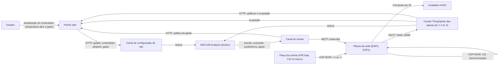

# Sistema IoT com Estimativa de Ocupação CSI para Automação da Climatização Predial — ESP32-C6

Sistema embarcado multi-placa em ESP32-C6 (ESP-IDF v6.0) que monitora um ambiente (temperatura, umidade e ocupação), controla um ar-condicionado por infravermelho imitando o controle remoto original, e coordena esses dados entre várias unidades ESP32 por Wi-Fi/MQTT e ESP-NOW. Na nuvem, um script MATLAB do ThingSpeak atua como **broker de controle** e um **painel web** permite ao operador escolher o controlador, o setpoint e acompanhar os dados.

O sistema tem quatro partes, cada uma com seu próprio código:

**Placas da rede** (`ESP0`, `ESP1`, …)

Consistem em duas ESP32-C6 que junto ao broker e ao painel, compõem a rede, leem sensores, estimam a ocupação, comandam o ar-condicionado e falam com o broker, cada uma por um canal próprio. Controlam a temperatura por meio de três tipos diferentes de controladores, com o tipo e a temperatura alvo determinados pelo broker.

**Placas das cortinas**

Detectam entradas e saídas pelas portas e enviam só a variação de ocupação (`+1` / `-1`) por ESP-NOW

Consistem em duas ESP32-C6 externas à rede, funcionando por sensor de presença PIR, são apenas placeholder para a cortina final, que será por CSI.

Para a rede não importa verdadeiramente como as cortinas funcionam ou o que fazem, basta que envie o numero de entradas/saídas por ESPNOW e nada mais.

**Broker ThingSpeak**

Lê os dados das placas e do painel, coordena o comportamento desejado para as unidades HVAC e define os parâmetros para os diferentes tipos de controlador.

É realizado por meio de um MATLAB Analysis no ThingSpeak, acionado por um react que observa o canal do painel web

**Painel web LARA Control**

Interface para os usuários, permite selecionar: o tipo controlador(alteração bloqueada por senha) e a temperatura alvo; além de permitir acompanhar por gráficos o gasto energético, temperatura de cada área e a ocupação.

Permite também a publicação do valor exibido no leitor de consumo energético, para monitorar o gasto energético de cada controlador.

link: https://laracontrol.netlify.app/

----------

## Arquitetura geral



Princípios do desenho:

-   **A cortina só informa a derivada da ocupação.** Quem soma as variações em um número de pessoas é o `main.c` das placas da rede. Trocar a cortina PIR pela CSI não exige mudança nas placas da rede.
-   **Duas vias de comunicação com papéis distintos.** _Intercom_ (MQTT) liga as placas ao broker na nuvem; _intracom_ (ESP-NOW) liga as placas à cortina, sem depender de internet.
-   **A conversa com o broker é um "pingue-pongue".** A placa publica seus dados, o MATLAB responde com uma instrução, a placa a aplica e publica de novo. Se o broker manda a placa "dormir" (`ESPactive = 0`), ela para de publicar até detectar uma nova chegada de pessoas.

----------

## Visão geral do hardware

### Placas da rede


| Periférico | GPIO | Arquivo |

|---|---|---|

| DS18B20 (temperatura, 1-Wire) | 0 | `temperature.c/h` |

| DHT22 (temperatura + umidade) | 1 | `humidity.c/h` |

| TSOP (receptor IR) | 4 | `identify.cpp/h` |

| LED IR (via transistor, emissor) | 5 | `emiter.cpp/h` |

| Botões (placeholder de ocupação) | 6 e 7 | `curtain.c/h` |

| LED RGB integrado da placa | 8 | `curtain.c` |

### Placa da cortina (PIR)

| Periférico | GPIO | Arquivo |

|---|---|---|
| HC-SR501 | 4 e 5| `PIRcurtain.c/h` |

| LED RGB integrado da placa | 8 | `PIRcurtain.c` |

Por consumirem tempo considerável, as leituras dos sensores de temperatura são implementadas como funções comuns, chamadas sob demanda, assim como o envio de dados para o broker, a leitura da cortina funciona por tarefa no entanto. O módulo de identificação de IR (`identify.cpp`), também roda como tarefa contínua porque não há como prever quando um sinal infravermelho vai chegar, e serve apenas para detecção do protocolo de comunicação com o HVAC, não para uso contínuo.

----------

## Visão geral da rede

Cada instalação é composta por várias placas ESP32-C6 que rodam o mesmo firmware (as da rede), cada uma responsável por um ambiente, mais a placa da cortina. O fluxo é:

1.  Ao ligar, cada ESP32 descobre **quem ele é** comparando seu MAC de fábrica com uma tabela fixa de dispositivos conhecidos (`MAC.c/h`).
2.  Em seguida, conecta ao Wi-Fi e inicializa o ESP-NOW. As placas da rede conectam também ao broker MQTT; a placa da cortina **não** (`coms_init(false)`).
3.  O laço principal (`main.c`) usa as duas vias:
    -   **Intercom** — MQTT, para trocar dados com o ThingSpeak (publicar leituras, receber instruções e parâmetros).
    -   **Intracom** — ESP-NOW, para receber a variação de ocupação da cortina e a mensagem de sincronização do `ESP0`.
4.  Com base nos sensores locais, nas instruções do broker e pela estratégia de controle selecionada `controlers.c`, cada placa decide quando e como acionar o ar-condicionado do seu ambiente pelo `emiter.c`.

----------

## `temperature.c` / `temperature.h` — Sensor de temperatura DS18B20

Lê a temperatura ambiente de um sensor DS18B20 conectado por **1-Wire**, um protocolo digital de um único fio onde o mestre (o ESP32) e o sensor se revezam controlando a linha, codificando informação na duração de cada pulso elétrico.

O arquivo implementa o protocolo inteiro "na mão" (bit-banging), sem biblioteca externa:

-   **`pin_config`** — configura o GPIO como entrada/saída de dreno aberto (necessário porque o mesmo fio é usado tanto para escrever quanto para ler), com pull-up habilitado como reforço ao resistor externo de 4,7 kΩ.
-   **`t_wellnesscheck`** — executa o pulso de reset do 1-Wire e verifica se o sensor respondeu com o pulso de presença, dentro de uma seção crítica (`portENTER_CRITICAL`/`portEXIT_CRITICAL`) para garantir que o timing em microssegundos não seja interrompido pelo escalonador do RTOS.
-   **`t_write_bit` / `t_read_bit`** — escrevem ou leem um único bit, seguindo os tempos exatos que o datasheet do DS18B20 exige para cada "slot" de bit.
-   **`t_write_byte` / `t_read_byte`** — montam/desmontam um byte completo a partir de 8 chamadas às funções de bit, respeitando a ordem LSB-primeiro do protocolo.
-   **`confirm_Sdigit`** — calcula o checksum CRC-8 (padrão Maxim, polinômio `0x8C`) sobre os bytes recebidos e compara com o byte de checksum que o próprio sensor envia junto, para detectar corrupção na transmissão.
-   **`t_wake_up`** — envia os comandos que instruem o sensor a iniciar uma conversão de temperatura (o processo demora até ~800 ms na resolução padrão de 12 bits).
-   **`t_read_sensor`** — lê o "scratchpad" de 9 bytes do sensor, valida o CRC, descarta leituras corrompidas ou vazias, e converte os dois bytes de temperatura (em complemento de dois, escala 1/16 °C) para um `float` em graus Celsius.

### API pública

```c
void DS18B20_init(void);
bool DS18B20_read(float *out_celsius);

```

`DS18B20_init` configura o pino e testa a presença do sensor uma vez, no início do programa. `DS18B20_read` dispara a conversão, aguarda o tempo necessário e devolve a leitura via ponteiro, retornando `false` em caso de falha (sensor ausente, CRC inválido, etc.).

----------

## `humidity.c` / `humidity.h` — Sensor de temperatura e umidade DHT22

Lê temperatura e umidade de um sensor DHT22, também por bit-banging, mas com um protocolo próprio do fabricante (diferente do 1-Wire): a informação de cada bit é codificada pela **duração do nível alto** de um pulso, não pela alternância de nível como no DS18B20.

-   **`pin_config`** — mesma ideia do módulo de temperatura: pino em dreno aberto com pull-up.
-   **`bit_length`** — espera a linha atingir um nível específico e devolve quanto tempo (em microssegundos) isso levou, ou `-1` se estourar um timeout — usado tanto para sincronizar o início da comunicação quanto para medir a duração de cada bit.
-   **`h_read_data`** — executa a sequência de "acordar" o sensor, espera a resposta de presença (três transições de nível) e lê os 40 bits (5 bytes) do quadro de dados, decidindo bit a bit se a duração do nível alto correspondeu a um 0 (~26 µs) ou um 1 (~70 µs), usando 45 µs como limiar.
-   **`confirm_Sdigit`** — verificação de integridade mais simples que o CRC do DS18B20: soma os 4 primeiros bytes e compara com o 5º byte enviado pelo sensor como checksum.
-   Conversão dos valores: separa os 16 bits de umidade e os 16 bits de temperatura, dividindo por 10 para obter uma casa decimal; a temperatura usa o bit mais significativo como sinalizador de valor negativo (diferente do complemento de dois do DS18B20).

### API pública

```c
void DHT22_init(void);
bool DHT22_read(dht22_reading_t *out);

```

`dht22_reading_t` é uma struct com dois campos (`temperature`, `humidity`), já que o sensor sempre lê os dois valores juntos em uma única transação.

----------

## `identify.cpp` / `identify.h` — Identificação e captura de sinais infravermelhos

Módulo baseado na biblioteca `IRremoteIDF` (github de Jorgecis) que escuta continuamente o receptor IR (TSOP) e decodifica qualquer sinal recebido, imprimindo:

-   uma descrição legível do protocolo detectado;
-   se for um sinal de ar-condicionado suportado, um resumo dos parâmetros (modo, temperatura, ventilação etc.);
-   o código-fonte já pronto do sinal bruto capturado (útil para reproduzir o mesmo sinal depois).

Diferente dos sensores, roda como uma **tarefa em loop infinito** (`identify_task`), porque não há como prever quando um sinal IR vai aparecer. É uma ferramenta de desenvolvimento, usada para capturar os timings do controle remoto original aplicados depois em `emiter.cpp`; o `main.c` atual **não** a inicializa.

### API pública

```c
void identify_init(void);

```

----------

## `emiter.cpp` / `emiter.h` — Emissor de comandos IR para o ar-condicionado

O atuador principal do projeto: monta e transmite comandos infravermelhos que imitam o controle remoto de um ar-condicionado Philco, usando o protocolo **GOODWEATHER** e a classe `IRGoodweatherAc` da biblioteca `IRremoteIDF`.

O `emiter.h` expõe uma API simplificada (`emiter_cmd_t`) com apenas os campos que o protocolo real possui — power, modo, temperatura, ventilação, oscilação da aleta e três "toggles" (turbo, luz do painel, sleep). Cada campo em zero/`*_KEEP` significa "não mexer nesse campo". Isso isola o resto do sistema dos detalhes internos da biblioteca.

### Peças internas

-   **`native_mode` / `native_fan` / `native_swing`** — funções tradutoras que convertem os enums da API pública para as constantes que a biblioteca espera, validando se o valor pedido é suportado pelo protocolo.
-   **`validate`** — confere todos os campos de um comando antes de qualquer transmissão, incluindo a faixa de temperatura aceita pelo protocolo.
-   **`convert_to_LARA`** — monta e transmite manualmente o quadro IR completo (cabeçalho, 6 bytes cada um seguido do seu complemento de bits, e rodapé), usando **timings medidos diretamente do controle remoto real** via captura com o TSOP (módulo `identify`), em vez dos timings genéricos da biblioteca. Isso foi necessário porque os tempos padrão da biblioteca não batiam exatamente com o sinal do controle original.
-   **`send_frame`** — envia um frame único, respeitando uma pausa mínima (`interframe`) entre frames consecutivos de um mesmo comando.
-   **`send_temp`** — trata a mudança de temperatura, que no protocolo real não é um valor absoluto, mas sim os botões "Up"/"Down"; pode operar em modo de salto direto ou grau a grau (configurável em tempo de compilação via `temp_step`).
-   **`emiter_init`** — cria o objeto de estado do ar-condicionado e o objeto de envio de baixo nível, carregando como estado inicial o quadro exato capturado do controle remoto real (ligado, modo frio, 24 °C, ventilação automática, oscilação lenta).
-   **`send_ir_command`** — a função central: para cada campo preenchido em um comando, aplica a mudança no objeto de estado e transmite um frame, sempre na ordem liga → modo → temperatura → ventilação → oscilação → toggles → desliga, protegida por um mutex para que dois comandos nunca sejam processados ao mesmo tempo.

Um detalhe importante do protocolo identificado: cada frame carrega o **estado completo** do ar-condicionado, não apenas o campo alterado — por isso o objeto interno precisa manter esse estado persistente entre chamadas.

### API pública

```c
bool emiter_init(void);
bool send_ir_command(const emiter_cmd_t *cmd);
// Exemplo: send_ir_command(&(emiter_cmd_t){ .power = EMITER_ON });

```

----------

## `curtain.c` / `curtain.h` — Ocupação nas placas da rede

Recebe a variação de ocupação nas placas da rede, por duas entradas que alimentam a mesma variável:

1.  **ESP-NOW**, vindo da placa da cortina (PIR hoje, CSI no futuro): a mensagem é um `float` em texto, `+x.0` para entradas e `-x.0` para saídas.
2.  **Dois botões físicos**, como entrada manual (útil para testes e correções):
3. 
|Entrada | Efeito em `carga_termica` | LED |

|---|---|---|

| Botão do GPIO 7| Soma `1` | Vermelho (`255, 0, 0`) |

| Botão do GPIO 6 | Subtrai `1` | Azul (`0, 0, 255`) |

| Ambos os botões | Subtrai `900`, o que zera a ocupação (o `main.c` limita `data[3]` em `0`) | Roxo (`128, 0, 128`) |

Tudo roda na tarefa `curtain_task` (pilha de 6144 bytes, prioridade 1), por _polling_ a cada 20 ms (`poll`):

A variável `carga_termica` (agora `float`) funciona como uma **caixa de correio**: ela só carrega a variação de ocupação ocorrida desde a última leitura. O número de pessoas em si fica em `data[3]`, no `main.c`, que a cada `data_interval` (8 s) soma `carga_termica` a `data[3]`, limita o resultado em no mínimo `0` e zera a caixa.

`curtain_init` configura os dois botões como entrada com pull-up, chama `led_init()` (que mora em `PIRcurtain.c`) e cria a tarefa.

### API pública

```c
extern float carga_termica;
void curtain_init(void);

```

----------

## `controlers.c` / `controlers.h` — Controladores de temperatura

Calculam, a cada `data_interval` (8 s), a **temperatura de setpoint a enviar ao ar-condicionado** a partir da temperatura medida, da ocupação e da temperatura-alvo pedida pelo operador. O resultado é um valor em °C (`new_temp`, no `main.c`). Ele só vai por IR quando difere do último enviado, no bloco de 17 s do laço principal.

A ideia comum a todos: o ar-condicionado tem seu próprio termostato, que desarma ao atingir o setpoint do controle remoto. Os controladores movem esse setpoint para baixo quando a sala está quente (forçando o ar a trabalhar) e para cima quando está confortável ou vazia (economizando energia).

| Controlador | `ControlType` | Usa ocupação | Usa histórico | Resumo |
|---|---|---|---|---|
| `LigaDesliga` | 1 | Não | Só a amostra atual | Liga/desliga com histerese entre dois setpoints fixos |
| `ControlPI` | 2 | Não | Sim (integral) | Proporcional + integral sobre o erro de temperatura |
| `ControlAdap` | 3 | Sim | Sim (duas integrais) | PI + compensação por pessoa, com ganho que se adapta |
| `Step` | 4 | Não | Não | Alterna entre setpoint mínimo e máximo em ciclo fixo |

### Histórico (`old_temps`)

`old_temps[2][HIST_LEN]` guarda as últimas leituras, uma por `data_interval`:

- `old_temps[HIST_OCUP]` (linha 0) guarda a ocupação e `old_temps[HIST_TEMP]` (linha 1) guarda a temperatura do DS18B20 (`data[0]`).
- O índice `0` é a amostra **mais recente**. O `main.c` desloca os dois vetores uma posição (`memmove`) antes de gravar a amostra nova.
- Tudo começa em `NaN`, e amostras `NaN` são ignoradas nos cálculos.
- `HIST_DT_S = 8` s e `HIST_LEN = 120 * (60/8 + 1) = 960` amostras. Como `60/8` é divisão inteira (7), isso dá 960 × 8 s = **128 min**, e não 120. É a maior janela que os controladores conseguem usar.

### Parâmetros usados

Todos vêm de `parameters[]` (ver `coms.c`) e podem ser trocados remotamente pelo broker.

| Índice | Macro | Padrão | Significado |
|---|---|---|---|
| 0 | `SET_MIN` | 20 | Menor setpoint que pode ser enviado ao ar (°C) |
| 1 | `SET_MAX` | 26 | Maior setpoint que pode ser enviado ao ar (°C) |
| 2 | `SET_PADRAO` | 23 | Setpoint usado quando não há leitura de temperatura nem setpoint anterior válido |
| 3 | `LD_BANDA` | 0,3 | Meia-banda da histerese do Liga/Desliga (°C) |
| 4 | `LD_SET_FRIO` | 20 | Setpoint enviado pelo Liga/Desliga enquanto "resfria" |
| 5 | `LD_SET_OCIOSO` | 26 | Setpoint enviado pelo Liga/Desliga quando "ocioso" |
| 6 | `PI_KP` | 1,0 | Ganho proporcional (°C de setpoint por °C de erro) |
| 7 | `PI_TI` | 15 | Tempo integral, em minutos (`PI_KI = PI_KP / PI_TI`) |
| 8 | `PI_JANELA` | 30 | Janela da integral do PI, em minutos |
| 9 | `PI_IMAX` | 3,0 | Limite da contribuição integral (°C), anti-*windup* |
| 10 | `AD_TREF_VAZIA` | 27 | Temperatura de referência do Adaptativo com a sala vazia |
| 11 | `AD_KFF0` | 0,25 | Ganho inicial por pessoa (°C de setpoint por pessoa) |
| 12 | `AD_GAMMA` | 0,002 | Taxa de adaptação do ganho por pessoa |
| 13 | `AD_JAN_AD` | 120 | Janela de adaptação do ganho, em minutos |
| 14 | `AD_KFF_MAX` | 1,0 | Teto do ganho por pessoa |
| 15 | `CORR_ACIMA` | 0,3 | Erro (°C) acima do alvo a partir do qual se força o setpoint mínimo |
| 16 | `CORR_ABAIXO` | −0,2 | Erro (°C) abaixo do qual a correção é liberada |
| 17 | `STEP_LIGADO_S` | 10800 | Duração do patamar "mínimo" do Degrau, em s (3 h) |
| 18 | `STEP_CICLO_S` | 14400 | Período total do Degrau, em s (4 h) |
| 19 | — | 0 | Não usado em `controlers.c` |

Como a string do broker carrega 3 dígitos por parâmetro e os índices 17 e 18 têm escala 3600, o broker envia esses dois em **horas** (`003` e `004`).

### Funções auxiliares

- **`clampf`** — limita um valor a um intervalo.
- **`janela(minutos)`** — converte uma janela em minutos para número de amostras (`minutos·60/8 + 1`), limitada a `HIST_LEN`.
- **`finaliza(v)`** — limita o setpoint a `[SET_MIN, SET_MAX]`, **arredonda para inteiro** (o ar só aceita passos de 1 °C), guarda em `ultimo_setp` e devolve.
- **`setp_anterior_valido`** — devolve `ultimo_setp` se for válido e estiver dentro dos limites; senão, `SET_PADRAO`. É o recurso usado quando falta leitura de temperatura.
- **`integral_hist(n, ref, pesar_ocup, &out)`** — integra pela regra do trapézio, da amostra mais antiga das `n` até a mais recente, o erro `(T − ref)`. Com `pesar_ocup`, multiplica cada erro pela ocupação (sempre ≥ 0; se uma amostra de ocupação for `NaN`, vale a última conhecida). O resultado está em °C·min (ou °C·pessoa·min). Devolve `false` se houver menos de 2 amostras válidas.
- **`corrige_compressor(erro)`** — histerese que decide se o controlador deve forçar o setpoint mínimo (ar a toda). Devolve `true` (forçar) quando o erro é ≥ `CORR_ACIMA`, ou quando o erro está entre `CORR_ABAIXO` e `CORR_ACIMA` **e** o último setpoint já era `SET_MIN`. Ou seja: uma vez forçado, o ar continua no mínimo até a sala esfriar `|CORR_ABAIXO|` °C abaixo do alvo; só então o controlador volta ao cálculo normal. Pelo nome, a intenção é manter o compressor trabalhando em vez de ciclar perto do alvo.

### Os controladores

#### `LigaDesliga(ocupação, temp_alvo)`

Ignora a ocupação. Mantém um estado "resfriando" com histerese em torno do alvo:

```
T >= alvo + LD_BANDA  ->  resfriando = true
T <= alvo - LD_BANDA  ->  resfriando = false
(entre os dois, ou T desconhecida, mantém o estado anterior)

setpoint = resfriando ? LD_SET_FRIO : LD_SET_OCIOSO
```

O ar-condicionado continua ligado: o que muda é o setpoint (20 °C ou 26 °C pelos padrões). Esses dois valores **não** passam pelo limite `[SET_MIN, SET_MAX]` de `finaliza`.

#### `ControlPI(ocupação, temp_alvo)`

Ignora a ocupação. Sem leitura de temperatura, repete o setpoint anterior válido. Com leitura:

1. Se `corrige_compressor(T − alvo)`, devolve `SET_MIN`.
2. Calcula a integral `I` do erro `(T − alvo)` na janela `PI_JANELA` (sem peso de ocupação) e a limita a `±PI_IMAX/PI_KI`, de modo que `PI_KI·I` nunca passe de `PI_IMAX`.
3. `delta = PI_KP·(T − alvo) + PI_KI·I`
4. Setpoint = `finaliza(alvo − delta)`.

Sala acima do alvo gera `delta` positivo, que baixa o setpoint e faz o ar trabalhar mais.

#### `ControlAdap(ocupação, temp_alvo)`

É o PI com um termo proporcional ao número de pessoas (*feedforward*) cujo ganho se ajusta sozinho:

1. **Ocupação**: usa a atual; se for `NaN`, a última do histórico; se continuar desconhecida, assume 0 e não considera a sala vazia.
2. **Ganho adaptativo**: `kff = AD_KFF0 + AD_GAMMA·Ikff`, onde `Ikff` é a integral, na janela `AD_JAN_AD`, do erro `(T − alvo)` **ponderado pela ocupação**. Se a sala esquentou com gente dentro, o ganho sobe; se esfriou, desce. O resultado é limitado a `[0, AD_KFF_MAX]`. Com poucos dados, vale `AD_KFF0`.
3. **Sala vazia** (ocupação conhecida e igual a 0): a referência passa de `alvo` para `AD_TREF_VAZIA` e a correção forçada de `SET_MIN` é pulada.
4. Fora da sala vazia, aplica `corrige_compressor(T − Tref)` e devolve `SET_MIN` se ela pedir.
5. Calcula `I` (janela `PI_JANELA`, referência `Tref`, sem peso de ocupação), limitado como no PI.
6. `delta = PI_KP·(T − Tref) + PI_KI·I + kff·ocupação`
7. Setpoint = `finaliza(Tref − delta)`.

Com a sala vazia, `Tref` (27 °C) fica acima de `SET_MAX` (26 °C), então o resultado costuma ser limitado em `SET_MAX`. Com o controlador Adaptativo ativo e ocupação `0`, o broker manda também desligar o ar-condicionado (ver o broker ThingSpeak). O ramo "sala vazia" só atua no intervalo antes de essa instrução ser aplicada.

#### `Step(ocupação, temp_alvo)`

Ignora os dois argumentos. Usa o tempo desde a inicialização (`esp_timer_get_time()` em segundos) módulo `STEP_CICLO_S`:

```
t = tempo_s % STEP_CICLO_S
setpoint = (t < STEP_LIGADO_S) ? SET_MIN : SET_MAX
```

Pelos padrões: 3 h em 20 °C seguidas de 1 h em 26 °C, repetindo. A fase do ciclo depende do instante em que a placa foi ligada. Serve para ensaios de resposta ao degrau, e é por isso que não tem campo de gasto energético no painel.

### Estado interno

`ultimo_setp` é uma variável única, **compartilhada entre os controladores**. Ao trocar de controlador, o novo parte do último setpoint calculado pelo anterior. Por isso a histerese de `corrige_compressor` pode herdar um `SET_MIN` de outro controlador.

### API pública
```c
#define HIST_DT_S  8
#define HIST_LEN   (120 * (60 / HIST_DT_S + 1))
#define HIST_OCUP  0
#define HIST_TEMP  1
extern float old_temps[2][HIST_LEN];

float LigaDesliga(float Ocupacao, float temp_alvo);
float ControlPI(float Ocupacao, float temp_alvo);
float ControlAdap(float Ocupacao, float temp_alvo);
float Step(float Ocupacao, float temp_alvo);
```

----------

## `PIRcurtain.c` / `PIRcurtain.h` — Cortina PIR (placa da cortina) e LED

A cortina PIR é um **placeholder** da cortina final baseada em CSI, desenvolvida em projeto paralelo por Guilherme França. Até a cortina CSI ficar pronta, ela fornece à rede o mesmo tipo de informação que a final vai fornecer, porém com confiabilidade drasticamente inferior. É administrada por **ESPs externos à rede**, que só enviam a variação de ocupação por ESP-NOW; o `main.c` dessa placa é apenas:

```c
void app_main(void)
{
    PIRcurtain_init();
}

```

Nas **placas da rede**, `PIRcurtain_init` não é chamada: o arquivo só entra no firmware como fornecedor das funções de LED (`led_init`, `led_set`, `led_blink`) usadas pelo `curtain.c`.

### Hardware e ligações

-   Fonte de **5 V** nos pinos 5V e GND da ESP32-C6. As trilhas passam primeiro por um capacitor **eletrolítico** de 100 µF e em seguida por um **cerâmico** de 100 nF entre 5 V e GND, e só depois alimentam os dois sensores PIR.
-   Cada `OUT` de PIR vai ao GPIO por um **resistor em série de 1 kΩ**, com um **pull-down de 10 kΩ** entre o GPIO e o GND.
-   Cada sensor fica em um **tubo impresso em PLA**, para enxergar apenas o que está diretamente à sua frente.
-   Convenção de sentido: **A** é o primeiro sensor cruzado ao entrar; **B**, ao sair.

### Inicialização (`PIRcurtain_init`)

1.  `led_init()` — cria o objeto do LED RGB integrado.
2.  `coms_init(false)` — comunicação **sem MQTT**: só ESP-NOW (`intracom`). A tabela `ESP[]` identifica a placa e lista os destinatários.
3.  Cria a fila `fila` (8 eventos).
4.  Configura os GPIO 4 e 5 como entrada, com pull-down interno e **interrupção na borda de subida**.
5.  Instala o serviço de interrupção e registra `isr_sensor` nos dois pinos (identificador `0` para A, `1` para B).
6.  Cria a tarefa `monitora_psg` (`"passagem"`, pilha de 4096 bytes, prioridade 5).

### Aquecimento

O HC-SR501 pode gerar disparos espúrios logo depois de ligado. Por isso a tarefa espera 500 ms e entra em **60 s de aquecimento**: o LED pisca em âmbar (`60, 20, 0`), o terminal mostra a contagem regressiva em uma única linha (sequências de escape ANSI) e a fila é esvaziada a cada segundo. No fim o LED apaga e a tarefa imprime `Monitorando`.

### Detecção e sentido

Depois do aquecimento, a tarefa funciona em ciclos:

1.  Espera, sem limite de tempo, o **primeiro evento** (borda de subida em A ou B).
2.  Espera até `janela` (1500 ms) por um **segundo evento**, que só confirma a passagem se vier do **outro** sensor.
3.  Decide o sentido pela ordem em que os sensores dispararam.
4.  Espera `bloqueio` (1000 ms) e esvazia a fila antes de aceitar nova detecção.

|Situação | Resultado| LED | ESP-NOW |

|---|---|---|

| A primeiro, B confirma na janela | Entrada |Vermelho (`60, 0, 0`) | Envia `+1.0` |

| B primeiro, A confirma na janela | Saída | Azul (`0, 0, 60`) | Envia `-1.0` |

| Só um sensor na janela | Sem sentido | Verde (`0, 60, 0`) | Nada |

Os instantes das bordas são medidos dentro da própria interrupção com `esp_timer_get_time()` (µs), então o intervalo impresso não depende do escalonamento da tarefa. O envio é `intracom_send(&direcao, -1)`, onde o `-1` significa **todos** os ESPs da tabela `ESP[]`. Só passagens confirmadas pelos dois sensores geram mensagem.

### Funções de LED

O LED integrado não é um GPIO liga/desliga, e sim um dispositivo endereçável WS2812 com protocolo próprio, controlado pelo componente `led_strip` (formato GRB, 1 LED, RMT a 10 MHz).

-   **`led_init`** — cria o dispositivo. Se falhar, o motivo vai para `error_code`, é impresso com o prefixo `curtain:` e o LED fica desativado: as demais funções de LED passam a não fazer nada e o resto do firmware segue normalmente.
-   **`led_set(ligado, r, g, b)`** — acende com a cor indicada ou apaga.
-   **`led_blink(r, g, b)`** — acende por `blink` ms e apaga, bloqueando a tarefa que a chamou.

### Contrato com a cortina

O que o `curtain.c` espera receber, e portanto o que qualquer cortina precisa enviar:
| Item | Valor |
|---|---|
| Meio | ESP-NOW (`intracom`), a todos os ESPs da rede |
| Formato | Um `float` em texto, no formato do `%f` (por exemplo `"1.000000"`) |
| Significado | Variação de ocupação: positivo = entrada, negativo = saída |
| Cortina PIR | Sempre `+1.0` ou `-1.0` |
| Valores reservados | Acima de `100`; a sincronização entre ESPs usa `101` |

### API pública

```c
void PIRcurtain_init(void);
void led_init(void);
void led_blink(int r, int g, int b);
void led_set(bool ligado, int r, int g, int b);

```

----------

## `MAC.c` / `MAC.h` — Identidade do dispositivo

Resolve um problema comum em sistemas com múltiplas placas idênticas rodando o mesmo firmware: **como cada ESP32 sabe qual é o seu papel** na rede, sem precisar gravar um firmware diferente para cada uma?

A solução usada aqui é uma tabela fixa, escrita no código, que associa o **endereço MAC de fábrica** de cada placa (único e imutável por dispositivo) a um índice/papel na rede:

```c
typedef struct {
    int com;
    uint8_t mac[6];
    bool Iam;
} ESP_t;

```

-   `mac` — o endereço MAC de 6 bytes daquele ESP específico.
-   `com` — um identificador numérico associado a esse dispositivo (por exemplo, um número de sala ou de nó).
-   `Iam` — marcado como `true` para a entrada que corresponde ao dispositivo que está rodando o código agora.

A tabela `ESP[]`, em `MAC.c`, lista os MACs de **todos** os ESP32 conhecidos da instalação, **inclusive a placa da cortina**, que precisa constar nela para trocar mensagens por ESP-NOW.

**`mac_init()`** lê o MAC de fábrica do dispositivo atual (`esp_read_mac`, usando a interface Wi-Fi como referência), percorre a tabela `ESP[]` procurando uma correspondência exata, e:

-   marca `Iam = true` na entrada correspondente;
-   guarda o índice encontrado na variável global `ESP_Iam` (ou deixa em `-1` se o MAC não constar na tabela — ou seja, uma placa "desconhecida" rodando o firmware).

`NUM_ESPS` é calculado automaticamente a partir do tamanho do array, então adicionar ou remover dispositivos da tabela não exige atualizar nenhum número manualmente. (O tamanho das tabelas de credenciais em `MQTT.h`, `ESPS_NUM`, precisa acompanhar esse número.)

`discover_mac()` é uma função auxiliar de depuração que apenas imprime o MAC de fábrica do dispositivo, útil para descobrir o endereço de uma placa nova antes de cadastrá-la na tabela `ESP[]`.

### API pública

```c
extern const int NUM_ESPS;
extern ESP_t ESP[];
extern int ESP_Iam;
void mac_init(void);
void discover_mac(void);

```

----------

## `coms.c` / `coms.h` — Conectividade e troca de mensagens

Concentra toda a configuração de rede (Wi-Fi, MQTT, ESP-NOW) e expõe funções simples para enviar/receber dados, escondendo os detalhes de cada protocolo do resto do programa.

### Inicialização (`coms_init(bool all)`)

O parâmetro escolhe o modo:

-   **`all = true`** (placas da rede): Wi-Fi + MQTT + ESP-NOW.
-   **`all = false`** (placa da cortina): Wi-Fi + ESP-NOW, **sem MQTT**.

Em sequência:

1.  `nvs_flash_init()` — armazenamento não volátil, exigido internamente pelo driver de Wi-Fi.
2.  `mac_init()` — descobre a identidade do dispositivo.
3.  `credentials_init()` — carrega, a partir da tabela `MQTT` de `MQTT.h`, as credenciais do dispositivo, indexadas por `ESP_Iam`.
4.  Configura e conecta o Wi-Fi em modo estação (`WIFI_MODE_STA`), com economia de energia desligada (`WIFI_PS_NONE`), aguardando bloqueado até obter IP. No modo `all`, define também o hostname da interface.
5.  **Só no modo `all`:** configura e conecta o cliente MQTT, aguardando bloqueado a confirmação.
6.  Monta a lista de "slaves" do ESP-NOW — todos os ESPs da tabela `ESP[]` exceto o próprio — e registra cada um como _peer_, permitindo envio direto sem roteador.

### Callbacks de evento

-   **`event_handler`** — Wi-Fi: inicia a conexão quando a interface sobe, marca como conectado ao obter IP e reconecta automaticamente em caso de queda.
-   **`mqtt_event_handler`** — MQTT: ao conectar, inscreve-se em **dois tópicos**, `MQTTsub` (instruções) e `MQTTpar` (parâmetros). Ao receber dados, separa pelo tópico: o de `MQTTpar` vai para `mqtt_parameters` (até 64 caracteres) e o resto para `mqtt_received` (até 20). Também registra desconexão e erros.
-   **`receive_msg`** — ESP-NOW: copia a mensagem recebida para o buffer `received_msg` (20 caracteres). Guarda só a **última** mensagem.

### Funções de envio/recebimento

| Função | Via | Propósito |
|---|---|---|
| `intercom_send(data)` | MQTT | Publica `data[0..4]` como `field1=…&field2=…&field3=…&field4=…&field5=…` (uma casa decimal), formato do ThingSpeak, no tópico `MQTTpub` (QoS 1). Devolve `false` se o MQTT não estiver conectado. |
| `wake_up(data)` | MQTT | Publica no mesmo formato, mas no tópico `MQTT.pub[0]` (o do `ESP0`). Existe, mas o `main.c` atual não a chama. |
| `intercom_read(out)` | MQTT | Copia a última instrução recebida para o chamador e limpa o buffer. Devolve `true` se havia mensagem. |
| `intercom_read_parameters()` | MQTT | Decodifica a última string de parâmetros recebida e atualiza `parameters[]` (ver abaixo). |
| `intracom_send(data, slave_index)` | ESP-NOW | Envia **um** `float` (como texto `%f`) a um ESP específico (`slave_index`) ou a todos (`-1`). Devolve `false` se algum envio falhar. |
| `intracom_read(out_msg)` | ESP-NOW | Copia a última mensagem local recebida e limpa o buffer. Devolve `true` se havia mensagem. |

### Parâmetros remotos — `parameters[20]` e `intercom_read_parameters`

`parameters[]` é um vetor global de 20 `float` que guarda os parâmetros ajustáveis dos controladores. Começa com valores padrão compilados e pode ser **substituído remotamente** por uma string de 60 dígitos publicada pelo broker no tópico `MQTTpar` (3 dígitos por parâmetro, multiplicados por uma escala por posição).

A função ignora a string se estiver vazia, tiver mais de 60 caracteres, for igual à anterior ou tiver caractere que não seja dígito. Strings curtas são completadas com zeros à esquerda até 60. Cada grupo de 3 dígitos vira `raw × escala`:

| Índice | Padrão | Escala | Índice | Padrão | Escala |
|---|---|---|---|---|---|
| 0 | 20 | ×1 | 10 | 27 | ×1 |
| 1 | 26 | ×1 | 11 | 0,25 | ×0,01 |
| 2 | 23 | ×1 | 12 | 0,002 | ×0,0001 |
| 3 | 0,3 | ×0,01 | 13 | 120 | ×1 |
| 4 | 20 | ×1 | 14 | 1,0 | ×0,01 |
| 5 | 26 | ×1 | 15 | 0,3 | ×0,01 |
| 6 | 1,0 | ×0,01 | 16 | −0,2 | ×(−0,01) |
| 7 | 15 | ×1 | 17 | 10800 | ×3600 |
| 8 | 30 | ×1 | 18 | 14400 | ×3600 |
| 9 | 3,0 | ×0,01 | 19 | 0 | ×1 |

A string de parâmetros hoje publicada pelo script MATLAB reproduz exatamente esses valores padrão. O significado de cada índice é definido nos controladores (`controlers.c`). Os índices 17 e 18 usam a escala 3600, o que sugere horas na string convertidas para segundos.

### API pública

```c
extern float parameters[20];

void coms_init(bool all);
void wake_up(const float *data);
bool intercom_send(const float *data);
bool intercom_read(char *out);
void intercom_read_parameters(void);
bool intracom_send(const float *data, int slave_index);
bool intracom_read(char *out_msg);

```

----------

## `MQTT.h` — Credenciais e configuração de rede (arquivo sensível)

Não é versionado com os dados reais. Concentra as definições usadas por `coms.c`: `SSID`, `SSIDp`, `MQTT_BROKER`, `MQTT_port`, `ESPS_NUM` e a struct `MQTT_t`, com uma linha de credenciais **por dispositivo**, indexada por `ESP_Iam`:

```c
typedef struct {
    char HOSTNAME[ESPS_NUM][32];
    char u[ESPS_NUM][32];     // usuário MQTT
    char p[ESPS_NUM][32];     // senha MQTT
    char c[ESPS_NUM][32];     // client id
    char id[ESPS_NUM][16];
    char pub[ESPS_NUM][64];   // tópico de publicação
    char sub[ESPS_NUM][64];   // tópico de instruções
    char par[ESPS_NUM][64];   // tópico de parâmetros
} MQTT_t;

```

`credentials_init()` copia a linha do dispositivo atual para as variáveis globais `HOSTNAME`, `MQTTu`, `MQTTp`, `MQTTc`, `MQTTid`, `MQTTpub`, `MQTTsub` e `MQTTpar`. Se `ESP_Iam == -1`, imprime "ESP não registrada" e não carrega nada.

----------

## `main.c` — Ponto de entrada e lógica de coordenação (placas da rede)

Inicializa os módulos (`curtain_init`, `emiter_init`, `DHT22_init`, `DS18B20_init`, `coms_init(true)`) e roda um laço a cada 200 ms que integra leitura de sensores, comunicação em rede, cálculo do controlador e comando do ar-condicionado.

### Estado principal

| Variável | Papel |
|---|---|
| `data[5]` | Estado local: `{DS18B20, DHT22 temperatura, DHT22 umidade, ocupação, mensagens}`. O quinto campo está reservado (hoje fica em `0`). |
| `old_data[5]` | Cópia da iteração anterior, para detectar a transição de ocupação de `0` para `>0`. |
| `ControlType` | Controlador ativo (começa em `1`), atualizado pelas instruções do broker. |
| `temp_alvo` / `new_temp` / `last_temp` | Setpoint vindo do broker, temperatura calculada pelo controlador e última temperatura enviada ao ar-condicionado. |
| `broker_msg` | Código do broker para esta placa; `9` significa "desligar o ar-condicionado". |
| `HVACon` | Se o ar-condicionado está, para este firmware, ligado. Evita comandos de power redundantes e permite repetir a tentativa se a transmissão IR falhar. |
| `command` | Último código de comando recebido (`1` = o broker espera resposta). |
| `LastBrokerMsg` / `LastDataMngt` | Instantes (s) da última troca com o broker/sincronização e da última leitura de dados. |
| `synchronize` | Valor de sincronização enviado pelo `ESP0` (`101.0`). |


### Controladores

A cada leitura de dados, o `main.c` empurra o histórico de ocupação e temperatura (`old_temps`) e escolhe a função que calcula a nova temperatura do ar-condicionado a partir da ocupação e do setpoint:

| `ControlType` | Controlador | Função |
|---|---|---|
| 1 | Liga/Desliga | `LigaDesliga(ocupação, temp_alvo)` |
| 2 | PI | `ControlPI(ocupação, temp_alvo)` |
| 3 | Adaptativo | `ControlAdap(ocupação, temp_alvo)` |
| 4 | Degrau | `Step(ocupação, temp_alvo)` |
| outro | Inválido | Imprime aviso e usa `LigaDesliga` |

Esses controladores estão em `controlers.c/h` e usam `parameters[]`.

### Ciclo do laço principal

1.  **Despertar** (quando `data[3]` passa de `0` para `>0`): o `ESP0` envia `101.0` aos demais por `intracom_send` (sincronização); a placa publica `data` por `intercom_send`, liga o ar-condicionado (`send_ir_command` com `power = EMITER_ON`), marca `HVACon` e registra `LastBrokerMsg`. Se o IR falhar, `HVACon` volta a `false`.
2.  **Obtenção de dados** (a cada `data_interval` = 8 s): soma `carga_termica` à ocupação `data[3]` (limitada em `0`) e zera a caixa; lê `DS18B20_read`/`DHT22_read`, atualizando `data[0..2]` quando a leitura é válida; atualiza o histórico e calcula `new_temp` pelo controlador ativo.
3.  **Envio ao broker** (quando passaram `broker_interval` = 15 s desde `LastBrokerMsg` **e** `command == 1`): publica `data` por `intercom_send`, zera `command` e renova `LastBrokerMsg`.
4.  **Leitura e aplicação de instruções** (quando passaram `HVAC_interval` = 17 s desde `LastBrokerMsg`):
    -   Chama `intercom_read_parameters()` e `intercom_read(instrucao)`.
    -   Decodifica a instrução de 6 dígitos `ABCDEF`: `AB` = temperatura alvo, `C` = controlador, `D` = mensagem para o `ESP0`, `E` = mensagem para o `ESP1`, `F` = comando.
    -   `ESP0` e `ESP1` atualizam `temp_alvo`, `ControlType` e `broker_msg` com o que lhes cabe (`D` ou `E`); outras placas ignoram a instrução.
    -   Se `new_temp` mudou desde o último envio, transmite o comando de temperatura ao ar-condicionado.
    -   Se `broker_msg == 9` e `HVACon` está ligado, transmite o comando de desligar; em caso de sucesso marca `HVACon = false` e, em caso de falha, mantém `true` para tentar de novo no ciclo seguinte.
5.  **ESP-NOW**: lê `intracom_read` e, se o valor for `101.0`, atualiza `LastBrokerMsg` (placa sincronizada com o `ESP0`).

Como o passo 3 só renova `LastBrokerMsg` quando `command == 1`, enquanto o broker mandar `ESPactive = 0` o passo 4 passa a rodar em todas as iterações: a placa fica em silêncio na nuvem, mas continua escutando instruções.

Todos os comandos ao ar-condicionado são montados com `memset(&cmd, 0, sizeof(cmd))` seguido do preenchimento apenas dos campos desejados, para que campos não usados fiquem no valor `*_KEEP` e não sejam alterados sem intenção.

Há variáveis herdadas sem uso no `main.c` atual: `blacked_out`, `wakeup_data` e `wellnescheck` (da antiga lógica de _heartbeat_ com `wake_up`).

----------

## Formatos de mensagem

| Trecho | Meio | Conteúdo |
|---|---|---|
| Cortina → placas da rede | ESP-NOW | `float` em texto: `+1.0` entrada, `-1.0` saída |
| `ESP0` → demais placas | ESP-NOW | `101.0` (sincronização) |
| Placa → canal ThingSpeak da placa | MQTT | `field1` DS18B20, `field2` DHT22 temp., `field3` DHT22 umid., `field4` ocupação, `field5` mensagens |
| Painel → canal de configuração | HTTP | `field1` controlador, `field2` setpoint, `field3` gasto energético (só quando pendente) |
| MATLAB → canal do broker | ThingSpeak | `field1` comando de 6 dígitos, `field2` parâmetros (60 dígitos), `field3..5` gasto por controlador (`-1` marca troca de controlador) |
| Canal do broker → placas | MQTT | Instrução em `MQTTsub`, parâmetros em `MQTTpar` |

Instrução (`ABCDEF`), construída como `SetPoint·10⁴ + ControlType·10³ + msg1·10² + msg2·10 + ESPactive`. Exemplo: `231111` = setpoint 23 °C, controlador 1, mensagens `1`/`1`, placas ativas.


----------

## Broker ThingSpeak (MATLAB Analysis)

O script MATLAB é o "cérebro" na nuvem. As chaves e os IDs de canal ficam fora do código versionado. A cada execução:

1.  **Lê** a última amostra (fields 1 a 5) de cada canal de placa e, do canal de configuração do painel, `ControlType`, `SetPoint` e `GastoEnergetico` (fields 1 a 3). A ocupação considerada é o **maior** `field4` entre os canais (ignorando `NaN`). Falhas de leitura são tratadas por canal, sem derrubar o script.
2.  **Respeita o intervalo mínimo** de 15 s desde a última gravação no canal do broker (limite do ThingSpeak gratuito), pausando se necessário.
3.  **Decide o comando** (`BrokerControl`): com controlador **Adaptativo (3)** e ocupação `<= 0`, envia mensagens `9`/`9` e `ESPactive = 0` (desligar e silenciar as placas). Nos demais casos envia `1`/`1`/`1`.
4.  **Contabiliza o gasto energético** por controlador: detecta troca de controlador comparando com o último comando gravado (`GetLastControlType`). Numa troca, grava `-1` nos três campos de gasto, como marca; com um gasto novo e controlador válido (1 a 3), grava o valor no campo do controlador ativo.
5.  **Grava no canal do broker**: `field1` comando, `field2` string de parâmetros (60 dígitos, hoje igual aos padrões de `coms.c`) e, quando há gasto novo ou troca, `field3..5`.

----------

## Painel web LARA Control (`thingspeak.html`)

Página de arquivo único (HTML + CSS + JavaScript puro, com Chart.js via CDN), hospedado na netlify, que conversa direto com a API REST do ThingSpeak. Seções: temperatura desejada (16 a 27 °C), temperatura por área (um gráfico por ar-condicionado), gasto energético (envio e gráfico do controlador ativo), ocupação e tipo de controlador (troca mediante senha).

| Canal | Papel | Operação |
|---|---|---|
| Configuração do site | Controlador, setpoint e gasto | Escrita |
| Ar 1 e Ar 2 | Temperatura (`field1`) e ocupação (`field4`) das placas | Leitura |
| Broker | Gasto por controlador (`field3..5`) | Leitura |

Funcionamento essencial:


-   **Confirmar não publica na hora**: os botões apenas atualizam variáveis internas; quem publica é um ciclo de **17 s** (acima dos 15 s mínimos do ThingSpeak). Os gráficos atualizam a cada 20 s.
-   **Com ocupação 0, o site fica em silêncio**, a menos que haja um gasto energético pendente (que força a publicação, levando junto controlador e setpoint).
-   O gasto só é considerado enviado depois que o ThingSpeak confirma a gravação; o mesmo valor não pode ser reenviado em seguida.
-   O gráfico de gasto usa o campo do broker correspondente ao controlador ativo (1 → `field3`, 2 → `field4`, 3 → `field5`); o **Degrau (4)** não tem campo de gasto.
----------

## Dependências externas de bibliotecas

-   **`IRremoteIDF`** (github de Jorgecis) — usada por `emiter.cpp` (classe `IRGoodweatherAc`, `IRsend`) e `identify.cpp` (`IRrecv`, `IRutils`, `IRac`) para codificação/decodificação de sinais infravermelhos.
-   **`led_strip`** — componente do ESP-IDF usado por `PIRcurtain.c` para controlar o LED RGB endereçável (WS2812) integrado da placa.
-   **FreeRTOS** (tarefas, filas) e **`esp_timer`** — usados pela cortina PIR e pelo `main.c`.
-   **Chart.js 4.4.1** (cdnjs) — gráficos do painel web.

## Estrutura de arquivos

```
Firmware das placas da rede (main/)
├── main.c                # Ponto de entrada e coordenação geral
├── MAC.c / MAC.h         # Identidade do dispositivo (tabela de MACs)
├── coms.c / coms.h       # Wi-Fi, MQTT, ESP-NOW e parâmetros remotos
├── MQTT.h                # Credenciais e configuração de rede (sensível)
├── controlers.c / .h     # Controladores (LigaDesliga, PI, Adaptativo, Degrau)
├── temperature.c / .h    # Sensor DS18B20 (1-Wire)
├── humidity.c / .h       # Sensor DHT22
├── identify.cpp / .h     # Captura e decodificação de sinais IR (desenvolvimento)
├── emiter.cpp / .h       # Emissor de comandos IR para o ar-condicionado
├── curtain.c / .h        # Ocupação: ESP-NOW da cortina + botões manuais
└── PIRcurtain.c / .h     # Funções de LED (usadas aqui) e cortina PIR

Firmware da placa da cortina (main/)
├── main.c                # Apenas importações e app_main() { PIRcurtain_init(); }
├── PIRcurtain.c / .h     # Detecção PIR, sentido, envio por ESP-NOW e LED
├── coms.c / .h           # Comunicação (aqui, só ESP-NOW: coms_init(false))
└── MAC.c / .h            # Identidade da placa e tabela de ESPs

Nuvem e interface
├── Broker ThingSpeak     # Script MATLAB Analysis (dados sensíveis omitidos)
└── thingspeak.html       # Painel web LARA Control (publicar como index.html)

```