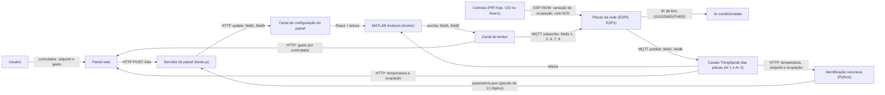

# Sistema IoT com Estimativa de Ocupação CSI para Automação da Climatização Predial — ESP32-C6

Sistema embarcado multi-placa em ESP32-C6 (ESP-IDF v6.0) que monitora as áreas do Laboratório de Automação e Robótica (LARA) da UnB (temperatura, umidade e ocupação), controla os ar-condicionados por infravermelho imitando o controle remoto original e coordena esses dados entre várias placas por Wi-Fi/MQTT e ESP-NOW. Na nuvem, um script MATLAB do ThingSpeak atua como **broker de controle** e um **painel web** permite ao operador escolher o controlador e o setpoint, registrar o gasto energético e acompanhar os dados. Um **servidor Node.js** intermedeia as publicações do painel no canal de configuração, e uma **tarefa em Python** recalcula periodicamente os parâmetros dos controladores a partir dos dados reais (identificação recursiva).

O objetivo é comparar estratégias de controle de temperatura (liga/desliga, PI, adaptativo com ocupação, degrau e direto) quanto ao conforto térmico e ao gasto energético.

O sistema tem seis partes, cada uma com seu próprio código:

**Placas da rede** (`ESP0` e `ESP1`)

Duas ESP32-C6, uma por área controlada. Cada uma lê os sensores, acumula a ocupação vinda da sua cortina, roda localmente o controlador escolhido pelo broker e comanda o seu ar-condicionado. Cada placa publica em um canal ThingSpeak próprio.

**Placas das cortinas** (`ESP2` e `ESP3`)

Duas ESP32-C6 externas à rede, uma por porta. Detectam entradas e saídas com dois sensores PIR e enviam a variação de ocupação por ESP-NOW à placa da rede da sua área (`ESP2 → ESP0`, `ESP3 → ESP1`). São um placeholder da cortina final, baseada em CSI, desenvolvida em trabalho paralelo. Para a rede não importa como a cortina funciona: basta que ela envie a variação de ocupação por ESP-NOW.

**Broker ThingSpeak**

Script MATLAB Analysis, disparado por um React que observa o canal do painel. Lê os canais das placas e do painel, soma a ocupação, decide se os ar-condicionados devem continuar ligados, escolhe entre dois vetores de parâmetros dos controladores conforme a ocupação e ecoa ocupação e alertas de volta às placas.

**Painel web LARA Control**

Interface do operador: setpoint, tipo de controlador (com senha), registro do gasto energético e gráficos de temperatura por área, ocupação e gasto.

link: https://laracontrol.netlify.app/

**Servidor do painel**

Programa Node.js, sem dependências externas, que recebe a lista do painel (controlador, setpoint, estado e gasto) e a publica no canal de configuração respeitando o intervalo de 17 s. Também anexa a cada publicação o pacote de parâmetros calculado pela identificação recursiva.

**Identificação recursiva**

Tarefa em Python que, a cada 5 minutos, lê os dados das placas, atualiza por mínimos quadrados recursivos o modelo térmico das áreas e recalcula `Kp`, `Ti` e `kff0`. O resultado vai ao servidor, que o publica, e ao broker, que o aplica.

----------

## Arquitetura geral



Princípios do desenho:

-   **A cortina só informa a variação da ocupação.** Quem acumula as variações é o `main.c` de cada placa da rede, e quem soma as áreas é o broker. Trocar a cortina PIR pela CSI não exige mudança nas placas da rede.
-   **Duas vias de comunicação com papéis distintos.** _Intercom_ (MQTT) liga as placas ao broker na nuvem; _intracom_ (ESP-NOW) liga as cortinas às placas, sem depender de internet.
-   **Nenhum evento de ocupação se perde.** A cortina reenvia até receber o ACK do ESP-NOW; a placa publica um **nível acumulado** (não um delta) e só o zera quando o broker confirma, por eco, que já o contabilizou.
-   **A identificação roda fora do broker.** O script MATLAB já é lento, então o recursivo é um programa separado. Ele entrega os parâmetros ao servidor, que os publica no canal de configuração junto com o restante, e o broker só escolhe qual vetor usar.
-   **O controle roda na borda.** O broker só escolhe o controlador, o setpoint e os parâmetros; o cálculo do setpoint enviado ao ar é feito em cada placa, sobre a temperatura da sua área.

----------

## Hardware

### Placas da rede

| Periférico | GPIO | Arquivo |
|---|---|---|
| DS18B20 (temperatura, 1-Wire) | 0 | `temperature.c/h` |
| DHT22 (temperatura e umidade) | 1 | `humidity.c/h` |
| TSOP4838 (receptor IR) | 4 | `identify.cpp/h` |
| LED IR TSAL6200 (via 2N2222) | 5 | `emiter.cpp/h` |
| Botões (entrada manual de ocupação) | 6 e 7 | `curtain.c/h` |
| LED RGB WS2812 integrado da placa | 8 | `PIRcurtain.c` (funções de LED) |

Componentes: ESP32-C6 N16 DevKit, DS18B20, DHT22, TSOP4838, TSAL6200, 2N2222, L7805CV, fonte 12 V 1 A, push buttons.

Alimentação: fonte de 12 V → L7805CV → 5 V no pino 5V da devkit → regulador da própria devkit → 3V3, que alimenta a ESP, os sensores e o LED IR.

Emissor IR: o LED fica entre o 3V3 e o coletor do 2N2222 (com resistor limitador em série), o emissor vai ao GND, e a base é acionada pelo GPIO 5 por um resistor, com 10 kΩ de base para o GND.

### Placas das cortinas (PIR)

| Periférico | GPIO | Arquivo |
|---|---|---|
| HC-SR501, sensor A | 4 | `PIRcurtain.c/h` |
| HC-SR501, sensor B | 5 | `PIRcurtain.c/h` |
| LED RGB integrado da placa | 8 | `PIRcurtain.c` |

-   Fonte de **5 V** nos pinos 5V e GND da ESP32-C6, passando por um capacitor eletrolítico de 100 µF e um cerâmico de 100 nF antes de alimentar os dois sensores.
-   Cada `OUT` de PIR vai ao GPIO por um resistor em série de 1 kΩ, com pull-down de 10 kΩ entre o GPIO e o GND.
-   Cada sensor fica em um tubo impresso em PLA, para enxergar só o que está à sua frente.
-   Convenção de sentido: **A** é o primeiro sensor cruzado ao entrar; **B**, ao sair.

----------

## Identidade das placas e papéis

Todas as placas rodam firmware a partir do mesmo código-fonte; cada uma descobre seu papel comparando o MAC de fábrica com a tabela `ESP[]` de `MAC.c`:

| Índice (`ESP_Iam`) | Papel |
|---|---|
| 0 | Placa da rede, área do Ar 1 (dezena do alerta, `msgA` da instrução) |
| 1 | Placa da rede, área do Ar 2 (unidade do alerta, `msgB` da instrução) |
| 2 | Cortina PIR que envia ao `ESP0` |
| 3 | Cortina PIR que envia ao `ESP1` |
| 4 a 6 | Cadastradas, sem papel atribuído |

A ordem importa: o broker lê os canais na ordem `ESP0`, `ESP1`, e a instrução e o alerta são posicionais.

----------

## `main.c` — Ponto de entrada e coordenação (placas da rede)

Inicializa os módulos (`curtain_init`, `emiter_init`, `DHT22_init`, `DS18B20_init`, `coms_init(true)`; o LED fica âmbar enquanto conecta) e roda um laço a cada **200 ms**.

### Estado principal

| Variável | Papel |
|---|---|
| `data[6]` | `{DS18B20, DHT22 temperatura, DHT22 umidade, ocupação acumulada, alerta, setpoint calculado}`, publicado como `field1..field6` |
| `ocupation` | Ocupação total ecoada pelo broker (`field6`); `NaN` até o primeiro eco. É a ocupação usada pelos controladores |
| `pub1`, `pub2` | Os dois últimos valores de `data[3]` publicados |
| `ControlType` | Controlador ativo (começa em `1`) |
| `temp_alvo` | Temperatura-alvo vinda do broker |
| `new_temp` / `last_temp` | Setpoint calculado pelo controlador / último setpoint transmitido com sucesso ao ar |
| `broker_msg` | Mensagem do broker para esta placa (`9` = desligar o ar) |
| `HVACon` | Se o ar está ligado, do ponto de vista do firmware |
| `command` | Último dígito `F` da instrução |
| `IRerror` / `COMSerror` | Falhas consecutivas de IR e de publicação MQTT |
| `LastBrokerMsg` / `LastDataMngt` | Instantes (s) da última publicação e da última leitura de dados |

### Temporização

| Constante | Valor | Uso |
|---|---|---|
| `reading_interval` | 4 s | A partir de 4 s após a última publicação, cada volta do laço lê e aplica o que o broker enviou |
| `data_interval` | 8 s | Ocupação, sensores, histórico e controlador |
| `broker_interval` | 15 s | Publicação no canal da placa (mínimo do ThingSpeak) |

### Ciclo do laço principal

1.  **Alertas de falha:** `IRerror ≥ 6` grava `6` em `data[4]`; `COMSerror ≥ 7` grava `7`. Os contadores voltam a zero.
2.  **Despertar:** se a placa tem ocupação local (`data[3] > 0`), o broker vê a sala vazia ou ainda não respondeu (`ocupation` `0` ou `NaN`) e o ar está desligado, a placa liga o ar na hora (`power = EMITER_ON`), marca `HVACon` e grava o alerta `2`. Se o envio falhar, `HVACon` volta a `false` e a tentativa se repete na próxima volta.
3.  **Leitura do broker** (de 4 s após a última publicação até a próxima):
    -   `intercom_read_parameters()` atualiza `parameters[]` se chegou uma string nova.
    -   **Ocupação** (`field6`): atualiza `ocupation`. Se ela for `≤ 0` **e** `data[3]` for igual aos dois últimos valores publicados, zera `data[3]`.
    -   **Alerta** (`field8`): extrai o dígito desta placa (dezena para o `ESP0`, unidade para o `ESP1`). Se for igual ao alerta pendente em `data[4]`, o alerta foi recebido e `data[4]` volta a `0`.
    -   **Instrução** (`field1`): decodifica `ABCDEF`; o `ESP0` e o `ESP1` atualizam `temp_alvo`, `ControlType` e `broker_msg` (`D` ou `E`).
    -   Se `broker_msg == 9` e o ar está ligado, envia o desligamento; em caso de falha mantém `HVACon` e tenta de novo.
    -   Se `new_temp` difere do último setpoint transmitido, envia a nova temperatura.
4.  **Obtenção de dados** (a cada 8 s):
    -   Soma `carga_termica` a `data[3]` e zera a caixa de correio. Se `data[3] ≤ −1000` (valor anormal), zera a ocupação e grava o alerta `8`.
    -   Lê o DS18B20 e o DHT22. Em falha, grava valores padrão (24 °C; 24 °C e 55 %).
    -   Desloca o histórico (`old_temps`), grava a ocupação do broker e a temperatura do DS18B20, roda o controlador ativo e guarda o resultado em `new_temp` e `data[5]`.
5.  **Publicação** (15 s após a última): `intercom_send(data)`. Em sucesso, desloca `pub2 ← pub1 ← data[3]`, zera `command` e renova `LastBrokerMsg`.

Os comandos ao ar são montados com `memset(&cmd, 0, sizeof(cmd))` e só os campos desejados são preenchidos, para que o resto fique em `*_KEEP`.

### Ocupação: nível acumulado com confirmação por eco

`data[3]` não é o número de pessoas da área: é o **saldo** de entradas e saídas da porta daquela placa desde o último zeramento, e pode ser negativo (quem entra por uma porta pode sair pela outra). O broker soma os saldos das duas placas e limita o total em `0`.

Publicar um nível em vez de um delta faz com que a placa possa publicar várias vezes entre duas execuções do broker sem perder ou duplicar eventos. O zeramento só acontece quando o broker diz que a sala está vazia **e** o saldo local não mudou nas duas últimas publicações, ou seja, o broker já o contabilizou.

### Alertas (`data[4]`)

`data[4]` é um único slot: o alerta mais recente substitui o anterior. Ele é publicado em `field5`, o broker o ecoa em `field8` (`ESP0·10 + ESP1`) e a placa o zera ao ver o próprio dígito no eco.

| Código | Origem | Significado |
|---|---|---|
| 2 | Despertar | O ar foi ligado por entrada de pessoa com a sala vazia |
| 6 | `IRerror ≥ 6` | Falhas repetidas de envio IR |
| 7 | `COMSerror ≥ 7` | Falhas repetidas de publicação MQTT |
| 8 | `data[3] ≤ −1000` | Ocupação anormal; o broker considera a ocupação total `0` |

### Sinais do LED (placas da rede)

| Cor | Evento |
|---|---|
| Âmbar fixo | Inicialização e conexão |
| Branco (piscada) | Comando IR enviado com sucesso |
| Magenta (piscada) | Instrução do broker recebida |
| Verde (piscada) | Publicação no broker |
| Vermelho / azul / roxo (piscada) | Botão 7 / botão 6 / os dois (`curtain.c`) |

Cada piscada bloqueia por 400 ms a tarefa que a chamou.

----------

## `controlers.c` / `controlers.h` — Controladores de temperatura

Calculam, a cada 8 s, o **setpoint a enviar ao ar-condicionado** a partir da temperatura medida, da ocupação ecoada pelo broker e da temperatura-alvo. O valor só vai por IR quando difere do último transmitido.

A ideia comum: o ar tem seu próprio termostato, que desarma ao atingir o setpoint do controle remoto. Os controladores baixam esse setpoint quando a sala está quente (o ar trabalha mais) e o sobem quando está confortável ou vazia (economia).

Todos têm a mesma interface, `float f(float Ocupacao, float temp_alvo)`.

| Controlador | `ControlType` | Usa ocupação | Usa histórico | Resumo |
|---|---|---|---|---|
| `LigaDesliga` | 1 | Não | Só a amostra atual | Alterna entre dois setpoints fixos com histerese |
| `ControlPI` | 2 | Não | Sim (integral) | Proporcional + integral sobre o erro de temperatura |
| `ControlAdap` | 3 | Sim | Sim (duas integrais) | PI + compensação por pessoa, com ganho que se adapta |
| `Step` | 4 | Não | Não | Alterna entre setpoint mínimo e máximo em ciclo fixo |
| `Direct` | 5 | Não | Não | Envia a temperatura-alvo diretamente |
| outro | — | — | — | O `main.c` imprime aviso e usa `LigaDesliga` |

### Histórico (`old_temps`)

-   `old_temps[HIST_OCUP]` (linha 0) guarda a ocupação do broker e `old_temps[HIST_TEMP]` (linha 1) a temperatura do DS18B20.
-   O índice `0` é a amostra **mais recente**; o `main.c` desloca os vetores com `memmove` antes de gravar a nova.
-   Tudo começa em `NaN`, e amostras `NaN` são ignoradas.
-   `HIST_DT_S = 8` e `HIST_LEN = 120 · (60/8 + 1) = 960` amostras. Como `60/8` é divisão inteira (7), isso cobre 960 × 8 s = **128 min**, a maior janela disponível.

### Parâmetros

Vêm de `parameters[]` (ver `coms.c`) e podem ser trocados remotamente pelo broker.

| Índice | Macro | Padrão | Significado |
|---|---|---|---|
| 0 | `SET_MIN` | 20 | Menor setpoint enviado ao ar (°C) |
| 1 | `SET_MAX` | 26 | Maior setpoint enviado ao ar (°C) |
| 2 | `SET_PADRAO` | 23 | Setpoint sem leitura de temperatura nem setpoint anterior válido |
| 3 | `LD_BANDA` | 0,3 | Meia-banda da histerese do Liga/Desliga (°C) |
| 4 | `LD_SET_FRIO` | 20 | Setpoint do Liga/Desliga ao resfriar |
| 5 | `LD_SET_OCIOSO` | 26 | Setpoint do Liga/Desliga ocioso |
| 6 | `PI_KP` | 1,0 | Ganho proporcional (°C de setpoint por °C de erro) |
| 7 | `PI_TI` | 15 | Tempo integral, em min (`PI_KI = PI_KP / PI_TI`) |
| 8 | `PI_JANELA` | 30 | Janela da integral, em min |
| 9 | `PI_IMAX` | 3,0 | Limite da contribuição integral (°C), anti-*windup* |
| 10 | `AD_TREF_VAZIA` | 27 | Referência do Adaptativo com a sala vazia |
| 11 | `AD_KFF0` | 0,25 | Ganho inicial por pessoa (°C por pessoa) |
| 12 | `AD_GAMMA` | 0,002 | Taxa de adaptação do ganho por pessoa |
| 13 | `AD_JAN_AD` | 120 | Janela de adaptação do ganho, em min |
| 14 | `AD_KFF_MAX` | 1,0 | Teto do ganho por pessoa |
| 15 | `CORR_ACIMA` | 0,3 | Erro (°C) a partir do qual se força `SET_MIN` |
| 16 | `CORR_ABAIXO` | −0,2 | Erro (°C) abaixo do qual a correção é liberada |
| 17 | `STEP_LIGADO_S` | 10800 | Duração do patamar mínimo do Degrau (s) |
| 18 | `STEP_CICLO_S` | 14400 | Período do Degrau (s) |
| 19 | — | 0 | Reservado |

### Funções auxiliares

-   **`clampf`** — limita um valor a um intervalo.
-   **`janela(minutos)`** — converte minutos em número de amostras (`minutos·60/8 + 1`), limitado a `HIST_LEN`.
-   **`finaliza(v)`** — limita a `[SET_MIN, SET_MAX]`, **arredonda para inteiro** (o ar só aceita passos de 1 °C), guarda em `ultimo_setp` e devolve.
-   **`setp_anterior_valido`** — `ultimo_setp` se válido e dentro dos limites; senão `SET_PADRAO`.
-   **`integral_hist(n, ref, pesar_ocup, &out)`** — integra pela regra do trapézio, da mais antiga das `n` amostras até a mais recente, o erro `(T − ref)`; com `pesar_ocup`, multiplica cada erro pela ocupação (≥ 0; amostra `NaN` herda a última conhecida). Resultado em °C·min (ou °C·pessoa·min). Devolve `false` com menos de 2 amostras válidas.
-   **`corrige_compressor(erro)`** — histerese que força `SET_MIN`: devolve `true` quando o erro é `≥ CORR_ACIMA`, ou quando está acima de `CORR_ABAIXO` e o último setpoint já era `SET_MIN`. Uma vez forçado, o ar fica no mínimo até a sala esfriar `|CORR_ABAIXO|` abaixo do alvo, evitando que o compressor cicle perto do alvo.

### Os controladores

#### `LigaDesliga`

O estado "resfriando" é deduzido do último setpoint (`ultimo_setp ≠ LD_SET_OCIOSO`, ou nenhum ainda):

```
T >= alvo + LD_BANDA  ->  resfriando = true
T <= alvo - LD_BANDA  ->  resfriando = false
(entre os dois, ou T desconhecida, mantém o estado)

setpoint = resfriando ? LD_SET_FRIO : LD_SET_OCIOSO
```

O ar continua ligado; o que muda é o setpoint. Esses dois valores não passam por `finaliza`.

#### `ControlPI`

Sem leitura de temperatura, repete o setpoint anterior válido. Com leitura:

1. Se `corrige_compressor(T − alvo)`, devolve `SET_MIN`.
2. Integra `(T − alvo)` na janela `PI_JANELA` e limita a integral a `±PI_IMAX/PI_KI`.
3. `delta = PI_KP·(T − alvo) + PI_KI·I`
4. Setpoint = `finaliza(alvo − delta)`.

#### `ControlAdap`

PI com um termo proporcional ao número de pessoas (*feedforward*) cujo ganho se ajusta sozinho:

1. **Ocupação**: a atual; se `NaN`, a última do histórico; se continuar desconhecida, vale 0 sem ser tratada como sala vazia.
2. **Ganho**: `kff = AD_KFF0 + AD_GAMMA·Ikff`, onde `Ikff` é a integral, na janela `AD_JAN_AD`, de `(T − alvo)` **ponderado pela ocupação**. Limitado a `[0, AD_KFF_MAX]`; com poucos dados vale `AD_KFF0`.
3. **Sala vazia** (ocupação conhecida e igual a 0): a referência passa a `AD_TREF_VAZIA` e a correção forçada é pulada.
4. Fora disso, `corrige_compressor(T − Tref)` pode devolver `SET_MIN`.
5. `delta = PI_KP·(T − Tref) + PI_KI·I + kff·ocupação`, com `I` como no PI.
6. Setpoint = `finaliza(Tref − delta)`.

Com ocupação `0`, o broker só manda desligar o ar no controlador Direto. No Adaptativo, o ramo de sala vazia atua enquanto a sala estiver vazia, com o vetor de parâmetros da sala vazia (ver abaixo).

#### `Step`

```
t = (segundos desde o boot) % STEP_CICLO_S
setpoint = (t < STEP_LIGADO_S) ? SET_MIN : SET_MAX
```

Pelos padrões: 3 h em 20 °C e 1 h em 26 °C, repetindo. A fase depende de quando a placa ligou. Serve para os ensaios em degrau usados na modelagem do ambiente.

#### `Direct`

Devolve `finaliza(temp_alvo)`: o setpoint pedido pelo operador, limitado a `[SET_MIN, SET_MAX]` e arredondado.

### Estado interno

`ultimo_setp` é **compartilhado entre os controladores**. Ao trocar de controlador, o novo parte do último setpoint do anterior, e a histerese de `corrige_compressor` pode herdar um `SET_MIN`.

### API pública

```c
#define HIST_DT_S 8
#define HIST_LEN (120 * (60 / HIST_DT_S + 1))
#define HIST_OCUP 0
#define HIST_TEMP 1
extern float old_temps[2][HIST_LEN];

float LigaDesliga(float Ocupacao, float temp_alvo);
float ControlPI(float Ocupacao, float temp_alvo);
float ControlAdap(float Ocupacao, float temp_alvo);
float Step(float Ocupacao, float temp_alvo);
float Direct(float Ocupacao, float temp_alvo);
```

----------

## `coms.c` / `coms.h` — Conectividade e troca de mensagens

Concentra Wi-Fi, MQTT e ESP-NOW e expõe funções simples de envio e leitura.

### Inicialização (`coms_init(bool all)`)

-   **`all = true`** (placas da rede): Wi-Fi + MQTT + ESP-NOW.
-   **`all = false`** (cortinas): Wi-Fi + ESP-NOW, sem MQTT.

Sequência:

1.  `nvs_flash_init()`, exigido pelo driver de Wi-Fi.
2.  `mac_init()` e `credentials_init()`.
3.  Wi-Fi em modo estação, com economia de energia desligada (`WIFI_PS_NONE`), bloqueando até obter IP. No modo `all`, define também o hostname.
4.  **Só no modo `all`:** cliente MQTT, bloqueando até conectar.
5.  ESP-NOW: monta a lista `slaves` com todas as placas da tabela exceto a própria, registra cada uma como _peer_, cria o semáforo de envio e registra os callbacks.

### Callbacks

-   **`event_handler`** (Wi-Fi): conecta quando a interface sobe, marca conectado ao obter IP e reconecta em caso de queda.
-   **`mqtt_event_handler`**: ao conectar, assina cinco tópicos do canal do broker e separa as mensagens recebidas por tópico em buffers próprios:

| Tópico (`MQTT.h`) | Field do broker | Buffer | Leitura |
|---|---|---|---|
| `MQTTsub` | 1 — instrução | `mqtt_received` | `intercom_read` |
| `MQTTpar` | 2 — parâmetros | `mqtt_parameters` | `intercom_read_parameters` |
| `MQTTocpt` | 6 — ocupação total | `mqtt_ocpt` | `intercom_ocupation` |
| `MQTTtime` | 7 — instante | `mqtt_time` | `intercom_timestamp` |
| `MQTTwarn` | 8 — eco dos alertas | `mqtt_warn` | `intercom_warnings` |

-   **`receive_msg`** (ESP-NOW): copia a mensagem para `received_msg`; guarda só a última.
-   **`send_result`** (ESP-NOW): grava se o envio teve ACK e libera o semáforo.

### Funções

| Função | Via | Propósito |
|---|---|---|
| `intercom_send(data)` | MQTT | Publica `data[0..5]` como `field1=…&…&field6=…` (uma casa decimal) no tópico da placa, QoS 1. Devolve `false` sem conexão MQTT |
| `intercom_read(out)` | MQTT | Copia a última instrução e limpa o buffer; `true` se havia mensagem |
| `intercom_ocupation(out)` | MQTT | Idem, para a ocupação |
| `intercom_warnings(out)` | MQTT | Idem, para o alerta |
| `intercom_timestamp(out)` | MQTT | Idem, para o instante (não usado pelo `main.c` atual) |
| `intercom_read_parameters()` | MQTT | Decodifica a string de parâmetros (abaixo) |
| `intracom_send(data, slave_index)` | ESP-NOW | Envia um `float` como texto (`%f`) a uma placa de `slaves` ou a todas (`-1`). Para cada envio, espera o ACK por até 70 ms; devolve `true` só se todos tiveram `ESP_NOW_SEND_SUCCESS` |
| `intracom_read(out_msg)` | ESP-NOW | Copia a última mensagem recebida e limpa o buffer |
| `wake_up(data)` | MQTT | Publica 5 fields no tópico do `ESP0` (não usada pelo `main.c` atual) |

### Parâmetros remotos — `parameters[20]`

Começam com os valores padrão compilados e podem ser substituídos por uma string de **60 dígitos** (20 grupos de 3) publicada pelo broker. A string é ignorada se estiver vazia, tiver mais de 60 caracteres, for igual à anterior ou tiver algo que não seja dígito; strings curtas são completadas com zeros à esquerda. Cada grupo vira `raw × escala`:

| Índice | Padrão | Escala | Índice | Padrão | Escala |
|---|---|---|---|---|---|
| 0 | 20 | ×1 | 10 | 27 | ×1 |
| 1 | 26 | ×1 | 11 | 0,25 | ×0,01 |
| 2 | 23 | ×1 | 12 | 0,002 | ×0,0001 |
| 3 | 0,3 | ×0,01 | 13 | 120 | ×1 |
| 4 | 20 | ×1 | 14 | 1,0 | ×0,01 |
| 5 | 26 | ×1 | 15 | 0,3 | ×0,01 |
| 6 | 1,0 | ×0,01 | 16 | −0,2 | ×(−0,01) |
| 7 | 15 | ×1 | 17 | 10800 | ×3600 |
| 8 | 30 | ×1 | 18 | 14400 | ×3600 |
| 9 | 3,0 | ×0,01 | 19 | 0 | ×1 |

Os índices 17 e 18 são enviados em horas (`003` e `004`). ### Dois vetores de parâmetros

O broker mantém dois vetores e publica um só, conforme a ocupação total: o da **zona ocupada** (ocupação > 0), que prioriza o conforto próximo de 23 °C, e o da **zona vazia** (ocupação = 0), que também mantém a temperatura próxima de 23 °C, porém com menor exigência, para economizar energia. Os controladores não escolhem o conjunto; apenas recebem o vetor publicado. Os dois são comuns às duas placas.

| Índice | Parâmetro | Zona ocupada | Zona vazia |
|---|---|---|---|
| 3 | `LD_BANDA` (°C) | 0,30 | 1,00 |
| 6 | `PI_KP` | 1,40 | 0,48 |
| 7 | `PI_TI` (min) | 14 | 14 |
| 10 | `AD_TREF_VAZIA` (°C) | 24 | 24 |
| 11 | `AD_KFF0` (°C/pessoa) | 0,66 | 0,66 |
| 12 | `AD_GAMMA` | 0,0018 | 0,0018 |
| 15 | `CORR_ACIMA` (°C) | 0,30 | 1,00 |
| 16 | `CORR_ABAIXO` (°C) | −0,20 | −0,67 |

Os demais índices têm o valor padrão da tabela acima. Strings iniciais (antes de qualquer atualização do recursivo):

```
ocupada: 020026023030020026140014030300024066018120100030020003004000
vazia:   020026023100020026048014030300024066018120100100067003004000
```

Os parâmetros `PI_KP`, `PI_TI` e `AD_KFF0` (índices 6, 7 e 11) dependem do modelo da sala e são **substituídos** pelo broker com o pacote da identificação recursiva (seção própria, abaixo). Os demais permanecem fixos.

### API pública

```c
extern float parameters[20];

void coms_init(bool all);
void wake_up(const float *data);
bool intercom_send(const float *data);
bool intercom_read(char *out);
bool intercom_timestamp(char *out);
bool intercom_ocupation(char *out);
bool intercom_warnings(char *out);
void intercom_read_parameters(void);
bool intracom_send(const float *data, int slave_index);
bool intracom_read(char *out_msg);
```

----------

## `MQTT.h` — Credenciais e configuração de rede (arquivo sensível)

Não é versionado com os dados reais. Define `SSID`, `SSIDp`, `MQTT_BROKER` (`mqtt://mqtt3.thingspeak.com`), `MQTT_port` (1883), `BROKERid`, `ESPS_NUM` e a struct `MQTT_t`, com uma linha por placa, indexada por `ESP_Iam`:

```c
typedef struct {
    char HOSTNAME[ESPS_NUM][32];
    char u[ESPS_NUM][32];     // usuário MQTT
    char p[ESPS_NUM][32];     // senha MQTT
    char c[ESPS_NUM][32];     // client id
    char id[ESPS_NUM][16];    // canal da placa
    char pub[ESPS_NUM][64];   // channels/<canal da placa>/publish
    char sub[ESPS_NUM][64];   // channels/<broker>/subscribe/fields/field1
    char par[ESPS_NUM][64];   // .../field2
    char time[ESPS_NUM][64];  // .../field7
    char ocpt[ESPS_NUM][64];  // .../field6
    char warn[ESPS_NUM][64];  // .../field8
} MQTT_t;
```

`credentials_init()` copia a linha da placa atual para as variáveis globais (`HOSTNAME`, `MQTTu`, `MQTTp`, `MQTTc`, `MQTTid`, `MQTTpub`, `MQTTsub`, `MQTTpar`, `MQTTtime`, `MQTTocpt`, `MQTTwarn`). Se `ESP_Iam == -1`, imprime "ESP não registrada" e não carrega nada. Como `coms_init` chama `credentials_init` em todas as placas, inclusive nas cortinas, `ESPS_NUM` precisa cobrir todos os índices cadastrados em `ESP[]`.

### Requisitos da rede local

-   Wi-Fi 2,4 GHz, com IP por DHCP.
-   Saída TCP na porta **1883** para `mqtt3.thingspeak.com` (MQTT sem TLS; publicação e assinatura na mesma conexão).
-   Saída UDP e TCP na porta **53** (DNS).
-   Todas as conexões partem das placas; nenhuma porta de entrada precisa ser aberta, basta o firewall permitir o tráfego de resposta.

----------

## `MAC.c` / `MAC.h` — Identidade do dispositivo

Cada placa descobre seu papel sem firmware diferente: uma tabela fixa associa o **MAC de fábrica** a um índice.

```c
typedef struct {
    int com;
    uint8_t mac[6];
    bool Iam;
} ESP_t;
```

-   `mac` — endereço de 6 bytes da placa.
-   `com` — número de identificação associado à placa.
-   `Iam` — `true` na entrada da placa que está rodando o código.

**`mac_init()`** lê o MAC da interface Wi-Fi (`esp_read_mac`), procura uma correspondência em `ESP[]`, marca `Iam` e grava o índice em `ESP_Iam` (`-1` se a placa não estiver cadastrada). Avisa se a tabela passar de 10 placas, o tamanho da lista de _peers_ em `coms.c`.

`NUM_ESPS` é calculado a partir do tamanho da tabela. `discover_mac()` só imprime o MAC, útil para cadastrar uma placa nova.

### API pública

```c
extern const int NUM_ESPS;
extern ESP_t ESP[];
extern int ESP_Iam;
void mac_init(void);
void discover_mac(void);
```

----------

## `curtain.c` / `curtain.h` — Ocupação nas placas da rede

Recebe a variação de ocupação por duas entradas que alimentam a mesma variável, `carga_termica`:

1.  **ESP-NOW**, vindo da cortina: a cada volta, `intracom_read` e `atof` convertem a mensagem e somam o valor.
2.  **Botões físicos**, para testes e correções:

| Entrada | Efeito em `carga_termica` | LED |
|---|---|---|
| Botão do GPIO 7 | `+1` | Vermelho (`255, 0, 0`) |
| Botão do GPIO 6 | `−1` | Azul (`0, 0, 255`) |
| Os dois juntos | `−1100`, que provoca o alerta 8 e zera a ocupação | Roxo (`128, 0, 128`) |

Tudo roda na tarefa `curtain_task` (pilha de 6144 bytes, prioridade 1), por _polling_ a cada 20 ms, com 50 ms de _debounce_ na borda de pressionar.

`carga_termica` funciona como **caixa de correio**: guarda só a variação desde a última leitura. O `main.c`, a cada 8 s, soma o conteúdo a `data[3]` e zera a caixa.

`curtain_init` configura os botões como entrada com pull-up, chama `led_init()` (de `PIRcurtain.c`) e cria a tarefa.

### API pública

```c
extern float carga_termica;
void curtain_init(void);
```

----------

## `PIRcurtain.c` / `PIRcurtain.h` — Cortina PIR e LED

A cortina PIR é o placeholder da cortina final baseada em CSI, desenvolvida em projeto paralelo por Guilherme França. O `main.c` das placas da cortina é apenas:

```c
void app_main(void)
{
    PIRcurtain_init();
}
```

Nas placas da rede, `PIRcurtain_init` não é chamada: o arquivo entra só como fornecedor das funções de LED.

### Inicialização (`PIRcurtain_init`)

1.  `led_init()`.
2.  `coms_init(false)`: Wi-Fi e ESP-NOW, sem MQTT.
3.  Escolhe o destino pelo índice da placa: `ESP2 → ESP0`, `ESP3 → ESP1`; qualquer outra envia a todas (`-1`).
4.  Cria a fila `fila` (8 eventos).
5.  GPIO 4 e 5 como entrada com pull-down e **interrupção na borda de subida**; `isr_sensor` registra o sensor (`0` = A, `1` = B) e o instante (`esp_timer_get_time`, µs) e põe o evento na fila.
6.  Cria as tarefas `monitora_psg` e `EnviaEvento` (pilha de 4096 bytes, prioridade 5).

### Aquecimento

O HC-SR501 gera disparos espúrios logo após ligar. A tarefa espera 500 ms e entra em **60 s de aquecimento**: LED piscando em âmbar (`60, 20, 0`), contagem regressiva em uma única linha do terminal (escape ANSI) e fila esvaziada a cada segundo. Depois imprime `Monitorando`.

### Detecção e sentido (`monitora_psg`)

1.  Espera, sem limite, o **primeiro evento**.
2.  Espera até `janela` (1500 ms) por um **segundo evento**, que só confirma a passagem se vier do **outro** sensor.
3.  Decide o sentido pela ordem e acumula em `direcao`.
4.  Espera `bloqueio` (1000 ms) e esvazia a fila.

| Situação | Resultado | LED | `direcao` |
|---|---|---|---|
| A primeiro, B confirma na janela | Entrada | Vermelho (`60, 0, 0`) | `+1` |
| B primeiro, A confirma na janela | Saída | Azul (`0, 0, 60`) | `−1` |
| Só um sensor na janela | Sem sentido | Verde (`0, 60, 0`) | Nada |

Como o instante de cada borda é medido na interrupção, o intervalo impresso não depende do escalonamento da tarefa.

### Envio com confirmação (`EnviaEvento`)

A tarefa dorme em `ulTaskNotifyTake` até `monitora_psg` registrar uma passagem. Então tenta `intracom_send(&direcao, ESPdestino)`:

-   **ACK recebido:** zera `direcao` e `COMSerrorPIR`.
-   **Falha:** incrementa `COMSerrorPIR`, espera 1 s e tenta de novo, até conseguir.

Passagens que acontecem enquanto um envio está pendente se somam em `direcao`, então a mensagem pode carregar `±2`, `±3` etc. Com `COMSerrorPIR ≥ 7`, o LED fica **branco fixo** (`150, 150, 150`) até um envio dar certo.

### Funções de LED

O LED integrado é um WS2812 endereçável, controlado pelo componente `led_strip` (GRB, 1 LED, RMT a 10 MHz).

-   **`led_init`** — cria o dispositivo. Se falhar, grava o motivo em `error_code`, imprime com o prefixo `curtain:` e deixa o LED desativado; as outras funções viram nulas e o firmware segue.
-   **`led_set(ligado, r, g, b)`** — acende com a cor ou apaga.
-   **`led_blink(r, g, b)`** — acende por 400 ms e apaga, bloqueando a tarefa que chamou.

### Contrato com a cortina

O que qualquer cortina (PIR ou CSI) precisa enviar:

| Item | Valor |
|---|---|
| Meio | ESP-NOW, à placa da rede da sua área |
| Formato | Um `float` em texto, no formato do `%f` (por exemplo `"1.000000"`) |
| Significado | Variação de ocupação desde o último envio confirmado: positivo = entradas, negativo = saídas |
| Confirmação | Reenviar até o envio ter ACK do ESP-NOW |

### API pública

```c
void PIRcurtain_init(void);
void led_init(void);
void led_blink(int r, int g, int b);
void led_set(bool ligado, int r, int g, int b);
```

----------

## `temperature.c` / `temperature.h` — Sensor DS18B20

Lê a temperatura por **1-Wire**, protocolo de um único fio em que o mestre e o sensor se revezam na linha e a informação está na duração de cada pulso. Todo o protocolo é implementado por bit-banging, sem biblioteca:

-   **`pin_config`** — GPIO 0 em dreno aberto (o mesmo fio escreve e lê), com pull-up interno reforçando o resistor externo de 4,7 kΩ.
-   **`t_wellnesscheck`** — pulso de reset (480 µs) e verificação do pulso de presença, com a amostragem dentro de uma seção crítica para que o escalonador não estrague o timing.
-   **`t_write_bit` / `t_read_bit`** — um bit por slot, com os tempos do datasheet, também em seção crítica.
-   **`t_write_byte` / `t_read_byte`** — 8 bits, LSB primeiro.
-   **`confirm_Sdigit`** — CRC-8 Maxim (polinômio `0x8C`) sobre os 8 primeiros bytes do scratchpad, comparado ao 9º.
-   **`t_wake_up`** — `Skip ROM` (`0xCC`) + `Convert T` (`0x44`).
-   **`t_read_sensor`** — `Skip ROM` + `Read Scratchpad` (`0xBE`), lê 9 bytes, valida o CRC, rejeita scratchpad vazio (`0xFF 0xFF`) e converte os dois bytes (complemento de dois, escala 1/16 °C) em `float`.

`DS18B20_read` dispara a conversão, espera 800 ms (`vTaskDelay`, sem ocupar a CPU) e lê. Bloqueia a tarefa chamadora por esse tempo, por isso é chamada sob demanda, a cada 8 s.

### API pública

```c
void DS18B20_init(void);
bool DS18B20_read(float *out_celsius);
```

----------

## `humidity.c` / `humidity.h` — Sensor DHT22

Lê temperatura e umidade por bit-banging, com o protocolo próprio do fabricante: cada bit é codificado pela **duração do nível alto**.

-   **`pin_config`** — GPIO 1 em dreno aberto com pull-up.
-   **`bit_length(nivel)`** — espera a linha chegar ao nível pedido e devolve quanto tempo levou, em µs, ou `-1` após 200 µs.
-   **`h_read_data`** — segura a linha em nível baixo por 1,2 ms (sinal de início), solta e, dentro de uma seção crítica, espera a resposta do sensor (três transições) e lê os 40 bits; nível alto acima de 45 µs é `1` (~70 µs), abaixo é `0` (~26 µs).
-   **`confirm_Sdigit`** — soma dos 4 primeiros bytes comparada ao 5º; converte umidade e temperatura (16 bits cada, ÷10). O bit mais significativo da temperatura é o sinal (não é complemento de dois).

### API pública

```c
typedef struct {
    float temperature;
    float humidity;
} dht22_reading_t;

void DHT22_init(void);
bool DHT22_read(dht22_reading_t *out);
```

----------

## `emiter.cpp` / `emiter.h` — Emissor IR para o ar-condicionado

Monta e transmite os comandos do controle remoto do ar-condicionado Philco, no protocolo **GOODWEATHER** (48 bits), com a classe `IRGoodweatherAc` da biblioteca `IRremoteIDF`.

### O protocolo

-   Cada quadro: cabeçalho, **6 bytes, cada um LSB primeiro e seguido do seu complemento** (96 bits no fio) e rodapé. Portadora de 38 kHz.
-   Protocolo "botão + estado": **todo quadro leva o estado completo** do ar (power, modo, temperatura, ventilação, oscilação) mais o código do botão apertado. Por isso o emissor mantém um estado persistente.
-   O quadro de ligar ressincroniza o ar com o estado guardado no emissor.

Timings usados (µs), medidos no controle remoto real com o TSOP:

| Elemento | Duração |
|---|---|
| Marca do cabeçalho | 6086 |
| Espaço do cabeçalho | 7374 |
| Marca de bit | 536 |
| Espaço de bit `1` | 540 |
| Espaço de bit `0` | 1630 |
| Espaço do rodapé | 7404 |

### API simplificada (`emiter_cmd_t`)

`power` (`KEEP`/`ON`/`OFF`), `mode`, `temp_c`, `fan`, `flap`, `turbo_toggle`, `light_toggle`, `sleep_toggle`. **Zero em qualquer campo significa "não mexer"**, o que isola o resto do sistema dos detalhes da biblioteca.

### Peças internas

-   **`native_mode` / `native_fan` / `native_swing`** — traduzem os enums da API para as constantes da biblioteca e rejeitam valores não suportados.
-   **`validate`** — confere todos os campos, inclusive a faixa de temperatura do protocolo, antes de transmitir qualquer coisa.
-   **`convert_to_LARA`** — monta e transmite o quadro manualmente com os timings medidos (ativado por `in_LARA`; com `0`, usa o `send()` padrão da biblioteca).
-   **`send_frame`** — transmite um quadro, com `interframe` (150 ms) entre quadros consecutivos de um mesmo comando.
-   **`send_temp`** — o protocolo muda temperatura por "Up/Down"; envia em um quadro só (`temp_step = 0`) ou grau a grau (`temp_step = 1`). Se a temperatura pedida já for a guardada no estado, **não transmite nada**.
-   **`emiter_init`** — cria o mutex e os objetos da biblioteca no GPIO 5 e carrega como estado inicial o quadro capturado do controle real, `0xD52806000000` (ligado, frio, 24 °C, ventilação automática, oscilação lenta).
-   **`send_ir_command`** — aplica cada campo preenchido e transmite um quadro por campo, na ordem liga → modo → temperatura → ventilação → oscilação → toggles → desliga, sob mutex.

O estado só existe na RAM: ao reiniciar a placa, ele volta a 24 °C ligado, independentemente do estado real do ar.

### API pública

```c
bool emiter_init(void);
bool send_ir_command(const emiter_cmd_t *cmd);
// send_ir_command(&(emiter_cmd_t){ .power = EMITER_ON });
```

----------

## `identify.cpp` / `identify.h` — Captura e identificação de sinais IR

Ferramenta de desenvolvimento, baseada na `IRremoteIDF`, que escuta o TSOP no GPIO 4 (buffer de 1024, timeout de 50 ms) e imprime para cada sinal:

-   o protocolo detectado;
-   se for um ar-condicionado suportado, o resumo do estado (modo, temperatura, ventilação etc.);
-   o código-fonte do sinal bruto capturado.

Roda como **tarefa contínua** (`identify_task`, pilha de 6144, prioridade 1), porque não há como prever quando um sinal chega. Foi com ela que o protocolo GOODWEATHER e os timings de `emiter.cpp` foram obtidos. O `main.c` das placas da rede **não** a inicializa.

### API pública

```c
void identify_init(void);
```

----------

## Programas de teste do IR

-   **`main_identify.c`** — só roda `identify_init()`. Usado em uma segunda placa para ler o que o emissor transmite e comparar o `Code:` impresso.
-   **`main_emiter.c`** — envia comandos por sequências de botões: os dois juntos iniciam (roxo), botão 6 = bit `0` (azul), botão 7 = bit `1` (branco), os dois de novo executam (laranja).

| Sequência | Comando |
|---|---|
| `000` | Ligar |
| `001` | Desligar |
| `010` | 18 °C |
| `011` | 20 °C |
| `100` | 22 °C |
| `101` | 26 °C |
| `110` | 28 °C |
| `111` | 30 °C |

Sequência inválida acende vermelho.

----------

## Formatos de mensagem

| Trecho | Meio | Conteúdo |
|---|---|---|
| Cortina → placa da rede | ESP-NOW | `float` em texto (`%f`): variação de ocupação |
| Placa → seu canal ThingSpeak | MQTT | `field1` DS18B20, `field2` DHT22 temp., `field3` DHT22 umid., `field4` ocupação acumulada, `field5` alerta, `field6` setpoint calculado |
| Painel → servidor | HTTP POST (`/api/lista`) | controlador, setpoint, estado (0 ou 1), gasto e senha |
| Servidor → canal de configuração | HTTP update | `field1` controlador, `field2` setpoint, `field3` gasto energético, `field4` estado, `field5` pacote de parâmetros (12 dígitos) |
| Broker → canal do broker | ThingSpeak | `field1` instrução, `field2` parâmetros, `field3..5` gasto por controlador, `field6` ocupação total, `field7` instante, `field8` eco dos alertas |
| Canal do broker → placas | MQTT | Assinatura dos fields 1, 2, 6, 7 e 8 |

### Pacote de parâmetros (`field5` do canal de configuração)

Inteiro de 12 dígitos, quatro grupos de 3: `KpOcup KpVazia Ti kff0`, cada um já na escala do vetor (`Kp` e `kff0` ×0,01; `Ti` em minutos). Exemplo: `140048014066` é `Kp` = 1,40 (zona ocupada), `Kp` = 0,48 (zona vazia), `Ti` = 14 min e `kff0` = 0,66. Um único número cabe com folga na precisão do ThingSpeak, o que não ocorreria com a string de 60 dígitos.

### Instrução (`ABCDEF`)

| Dígitos | Conteúdo |
|---|---|
| `AB` | Temperatura-alvo (°C) |
| `C` | Tipo de controlador (1 a 5) |
| `D` | Mensagem para o `ESP0` (`9` = desligar o ar) |
| `E` | Mensagem para o `ESP1` (`9` = desligar o ar) |
| `F` | `ESPactive` |

Construída como `SetPoint·10⁴ + ControlType·10³ + msg1·10² + msg2·10 + ESPactive`. Exemplo: `231111` = 23 °C, Liga/Desliga, mensagens `1`/`1`, ativo.

----------

## Broker ThingSpeak (MATLAB Analysis)

O script é o coordenador na nuvem, disparado por um React no canal do painel. As chaves e IDs ficam fora do código versionado. A cada execução:

1.  **Respeita o intervalo mínimo** de 15 s desde a última escrita no canal do broker (`IntervaloMinimo`), pausando se necessário.
2.  **Lê** a última amostra (fields 1 a 6) do canal de cada placa, com `try/catch` por canal, e, do canal de configuração, `ControlType`, `SetPoint`, `GastoEnergetico` e o pacote de parâmetros (`field5`).
3.  **Ocupação** (`GetOcupation`): soma os níveis acumulados das duas placas (`NaN` vale 0). Se alguma placa reportar o alerta `8`, a ocupação vale 0. Nunca fica negativa.
4.  **Alertas** (`Alertas`): codifica os alertas das duas placas como `ESP0·10 + ESP1`, devolvido em `field8` como eco.
5.  **Comando** (`BrokerControl`): com o controlador **Direto (5)** e ocupação `≤ 0`, envia mensagens `9`/`9` e `ESPactive = 0` (desligar os ares). Nos demais casos, `1`/`1`/`1`.
6.  **Parâmetros** (`MontaParametros`): parte de um dos dois vetores iniciais, escolhido pela ocupação (> 0: zona ocupada; caso contrário, zona vazia), e substitui `Kp`, `Ti` e `kff0` pelos valores do pacote. Se o pacote estiver ausente, for `NaN` ou estiver fora de `[0, 10¹²)`, publica o vetor inicial sem alterações.
7.  **Gasto energético**: detecta troca de controlador comparando com o dígito `C` da última instrução gravada (`GetLastControlType`). Numa troca, grava `-1` nos três campos de gasto como marca; com um gasto novo e controlador de 1 a 3, grava o valor no campo do controlador ativo.
8.  **Grava** no canal do broker: fields 1, 2, 6, 7 e 8 sempre; fields 3 a 5 também quando há gasto novo ou troca. O `field7` é o instante da escrita em segundos dentro da hora (`minuto·60 + segundo`).

----------

## Painel web LARA Control

Página de arquivo único (HTML + CSS + JavaScript, com Chart.js via CDN), hospedada na Netlify. Lê os canais pela API REST do ThingSpeak e envia a lista de configuração ao servidor do painel (seção seguinte), que a publica.

| Canal | Papel | Operação |
|---|---|---|
| Configuração | Controlador, setpoint, estado e gasto | Escrita, pelo servidor |
| Ar 1 e Ar 2 | Temperatura e ocupação das placas | Leitura |
| Broker | Gasto por controlador (`field3..5`) | Leitura |

-   **Setpoint** de 16 a 27 °C; **tipo de controlador** protegido por senha.
-   **Confirmar não publica na hora**: os botões atualizam variáveis internas e o ciclo de envio leva a lista ao servidor. Os gráficos atualizam a cada 20 s.
-   A regra de quando publicar no ThingSpeak (intervalo de 17 s, silêncio com o estado desligado e gasto pendente) é aplicada pelo servidor; o gasto só é considerado enviado depois que o ThingSpeak confirma a gravação, e o mesmo valor não é reenviado em seguida.
-   O gráfico de gasto usa o campo do broker do controlador ativo (1 → `field3`, 2 → `field4`, 3 → `field5`). O Degrau não tem campo de gasto, por ser usado em ensaios.

----------

## Servidor do painel (`servidor.js`)

Programa Node.js (`http`, `fs` e `crypto`, sem pacotes externos) que fica entre o painel e o ThingSpeak e roda continuamente no PC do laboratório. Escuta apenas em `127.0.0.1`; o acesso externo depende do que estiver à frente dele.

### Configuração

Variáveis em um arquivo `.env`, que **não é versionado**: chave de escrita do canal de configuração (`THINGSPEAK_WRITE_KEY`), senha do controlador (`SENHA_CONTROLADOR`), origem permitida do painel (`ALLOWED_ORIGIN`), porta (`PORT`, padrão 3000) e arquivo de estado (`ARQUIVO_ESTADO`). Sem as três primeiras o servidor não inicia.

### API

| Rota | Função |
|---|---|
| `POST /api/lista` | Recebe `{controlador, temperatura, estado, gasto, senha}` |
| `GET /api/estado` | Devolve a última lista (`controlador`, `temperatura`, `estado`) |

Validação: controlador inteiro de 1 a 5, temperatura de 16 a 27 °C, estado `0` ou `1`, gasto numérico opcional. A senha só é exigida quando o controlador ou o estado muda; 10 senhas erradas em 15 min bloqueiam novas tentativas. Há limite de 120 pedidos por minuto, corpo máximo de 10 KiB e verificação da origem (CORS).

### Publicação no canal de configuração

O servidor guarda a última lista em memória e a envia ao ThingSpeak com intervalo mínimo de **17 s**:

| Campo | Conteúdo |
|---|---|
| `field1` | Controlador |
| `field2` | Temperatura (setpoint) |
| `field3` | Gasto energético, só quando há valor pendente |
| `field4` | Estado (0 ou 1) |
| `field5` | Pacote de parâmetros, lido de `parametros.json` |

Regras de quando publicar:

-   **Forçada:** na subida do estado (0 → 1) ou quando há gasto pendente.
-   **Periódica:** a cada 17 s com o estado em 1; depois de uma descida (1 → 0), mais 4 envios.
-   **Fora disso**, não publica.

O `field5` vai em **toda** publicação, porque o broker lê apenas o último registro do canal. Por consequência, **os parâmetros só chegam às placas enquanto o servidor estiver publicando**. Se `parametros.json` não existir ou não tiver exatamente 12 dígitos, o campo é omitido e o broker usa os vetores iniciais.

### Persistência e registro

-   `estado.json`: última lista, contadores e gasto pendente; reaproveitado ao reiniciar.
-   `servidor.log`: uma linha por evento, com rotação a cada 2 MiB.

### Execução contínua

`instalar-inicio-automatico.ps1` registra a tarefa agendada "LARA Servidor" (início do Windows, conta de serviço, reinício a cada minuto em caso de falha, sem limite de tempo) com a pasta `dados` como diretório de trabalho, e a inicia.

----------

## Identificação recursiva (`recursivo.py`)

O modelo térmico das duas áreas é identificado em batelada (MATLAB, subespaços, método MOESP) e passa a ser atualizado continuamente por mínimos quadrados recursivos com fator de esquecimento. A cada atualização, os parâmetros dos controladores são recalculados.

### Fluxo

1.  Lê o último trecho dos canais das duas placas: `field1` (temperatura DS18B20), `field6` (setpoint calculado) e `field4` (ocupação acumulada). A ocupação total é a soma das duas placas, **suposta sem erro de contagem**.
2.  Reamostra em blocos: grade de 15 s, médias de **8 amostras (2 min)**. Cada leitura vale por até 45 s e um bloco precisa de pelo menos 4 leituras válidas; blocos incompletos são ignorados.
3.  Atualiza o RLS de cada saída (temperatura da área 0 e da área 1).
4.  Converte o modelo em ganho `K`, constante de tempo `τ`, atraso `θ` e ganho de ocupação `Kn`, calcula os parâmetros e grava o pacote.

O bloco de 2 min é necessário: com a grade de 15 s e o ruído do sensor (resolução de 0,0625 °C), o ARX estimado por mínimos quadrados subestima o ganho e a constante de tempo. Em simulação, a reamostragem eliminou esse viés.

### Modelo e RLS

-   ARX de múltiplas entradas, por saída, com entradas S0, S1 e Np, ordem 3 em cada polinômio e termo constante (16 parâmetros). Os dados são centrados pelas médias do ensaio em batelada.
-   Inicialização com o modelo em batelada: `A`, `B`, `C`, `D` (ordem 3, `Ts` = 15 s) e as médias de entradas e saídas, exportados por `exportar_modelo.m` para `modelo.json`. O modelo é discretizado para o período de 2 min e convertido em ARX por `ss2tf`, com denominador comum `det(zI − A)`.
-   Fator de esquecimento `λ = 0,995` (memória de cerca de 200 blocos, 6,7 h); covariância inicial `0,001·I`. O esquecimento é suspenso se o traço de `P` passar de 10³, para evitar divergência sem excitação.

### Parâmetros calculados

Para cada área, a resposta ao degrau do setpoint nas duas entradas S0 e S1 (modo comum) fornece `K` e, pelos instantes em que atinge 28,3 % e 63,2 % do valor final, `τ = 1,5·(t63 − t28)` e `θ = t63 − τ`. Os valores das duas áreas são **promediados**, pois o broker publica um vetor único. `Kn` é o ganho estático da ocupação.

| Parâmetro | Cálculo |
|---|---|
| `Kp` (zona ocupada) | `τ / [K (τ + θ)]` (sintonia por modelo interno, `λ = τ`) |
| `Kp` (zona vazia) | `τ / [K (3τ + θ)]` (`λ = 3τ`, malha três vezes mais lenta) |
| `Ti` | `τ` (min) |
| `kff0` | `Kn / K` |

### Validação e limites

-   Uma atualização é **descartada** se o modelo for instável, `K` sair de [0,1; 3] ou `τ` sair de [3; 60] min. O motivo vai ao histórico.
-   Faixas: `Kp` em [0,10; 9,99], `Ti` em [3; 120] min, `kff0` em [0; 0,99].
-   Cada parâmetro varia no máximo **5 %** por atualização em relação ao último valor aceito.
-   Sem excitação (setpoint e ocupação praticamente constantes), a estimativa não é confiável; o limite de variação protege os controladores, mas não substitui a análise do histórico.

### Saída

Os arquivos ficam na pasta de trabalho (`dados`):

| Arquivo | Conteúdo |
|---|---|
| `modelo.json` | Modelo em batelada (entrada, gerado no MATLAB) |
| `parametros.json` | `{"pacote": "KpOcup KpVazia Ti kff0", "t": ...}`, lido pelo servidor |
| `estado_recursivo.json` | `θ`, `P` e instante da última amostra; permite retomar após uma parada |
| `historico_parametros.csv` | Uma linha por ciclo: erro de predição (RMSE de cada área), validade, `K`, `τ`, `θ`, `Kn`, `Kp` (ocupada e vazia), `Ti`, `kff0` e pacote |
| `recursivo.log` | Uma linha por ciclo, com erros |

Para recomeçar do modelo em batelada, apague `estado_recursivo.json` com o programa parado.

### Execução

Ciclo de 5 min (`INTERVALO_CICLO`); na primeira execução baixa as últimas 6 h. Erros de rede são registrados e o ciclo seguinte tenta de novo. As chaves de leitura dos canais das placas ficam em constantes no início de `recursivo.py` (arquivo sensível: não versionar com as chaves reais).

Requisitos: Python 3.9 ou superior com `numpy` e `scipy` (`python -m pip install numpy scipy`).

Passos de instalação:

1.  No MATLAB, após o `passo1.m`, rodar `exportar_modelo.m`; copiar o `modelo.json` gerado para a pasta `dados`.
2.  Teste manual: dentro de `dados`, `python ..\recursivo.py`; deve aparecer `OK K=... tau=...`. Interromper com Ctrl+C.
3.  `instalar-recursivo.ps1` (PowerShell, na pasta do programa) registra a tarefa "LARA Recursivo" para o usuário atual, no logon, com `pythonw.exe` (sem janela), reinício a cada minuto em caso de falha e sem limite de tempo. Python instalado só para um usuário não é acessível à conta de serviço, por isso a tarefa roda no usuário.
4.  Confirmar, passados alguns minutos, que `recursivo.log` ganha uma linha a cada ciclo e que o `field5` do canal de configuração mostra o pacote (isto exige o servidor reiniciado com `lerPacote`).

----------

## Compilação

-   ESP-IDF **v6.0**, alvo `esp32c6`.
-   Dependências (`idf_component.yml`): `espressif/led_strip ^3.0.0` e `jorgecis/irremoteidf ^1.0.0`. No IDF 6 o `driver/gpio.h` pertence ao componente `esp_driver_gpio`, que precisa constar no `REQUIRES` da `IRremoteIDF`.
-   Tabela de partições **"Single factory app (large)"** e flash de **8 MB**: o binário com a biblioteca de IR passa de 1 MB.
-   `MQTT.h` não é versionado; crie o seu a partir da estrutura descrita acima.
-   Arquivos que usam a biblioteca de IR são `.cpp` e expõem a API com `extern "C"`.

----------

## Dependências externas

-   **`IRremoteIDF`** (Jorgecis), port do IRremoteESP8266 — `emiter.cpp` (`IRGoodweatherAc`, `IRsend`) e `identify.cpp` (`IRrecv`, `IRutils`, `IRac`).
-   **`led_strip`** — LED WS2812 integrado.
-   **FreeRTOS** (tarefas, filas, semáforos, notificações) e **`esp_timer`**.
-   **ESP-MQTT**, **ESP-NOW** e **esp_wifi**, do ESP-IDF.
-   **Chart.js 4.4.1** — gráficos do painel.

----------

## Estrutura de arquivos

```
Firmware das placas da rede (main/)
├── main.c                # Coordenação geral
├── MAC.c / MAC.h         # Identidade da placa (tabela de MACs)
├── coms.c / coms.h       # Wi-Fi, MQTT, ESP-NOW e parâmetros remotos
├── MQTT.h                # Credenciais e tópicos (sensível, fora do git)
├── controlers.c / .h     # LigaDesliga, PI, Adaptativo, Degrau, Direto
├── temperature.c / .h    # DS18B20 (1-Wire)
├── humidity.c / .h       # DHT22
├── emiter.cpp / .h       # Emissor IR GOODWEATHER
├── identify.cpp / .h     # Captura e identificação IR (desenvolvimento)
├── curtain.c / .h        # Ocupação: ESP-NOW da cortina + botões
└── PIRcurtain.c / .h     # Funções de LED (usadas aqui)

Firmware das placas das cortinas (main/)
├── main.c                # app_main() { PIRcurtain_init(); }
├── PIRcurtain.c / .h     # Detecção PIR, sentido, envio com ACK e LED
├── coms.c / .h           # Só ESP-NOW: coms_init(false)
├── MQTT.h                # Necessário para credentials_init
└── MAC.c / .h            # Identidade e tabela de placas

Testes do IR
├── main_identify.c       # Só o identify
└── main_emiter.c         # Comandos por sequência de botões

Nuvem e interface
├── Broker ThingSpeak     # Script MATLAB Analysis (chaves fora do git)
└── thingspeak.html       # Painel LARA Control (publicar como index.html)

Servidor e identificação (PC do laboratório)
├── servidor.js                    # Servidor do painel (Node.js)
├── .env                           # Chave, senha, origem e porta (sensível, fora do git)
├── instalar-inicio-automatico.ps1 # Tarefa "LARA Servidor"
├── recursivo.py                   # Identificação recursiva (Python)
├── instalar-recursivo.ps1         # Tarefa "LARA Recursivo"
├── exportar_modelo.m              # Exporta o modelo em batelada (MATLAB) para modelo.json
└── dados/                         # Pasta de trabalho
    ├── estado.json, servidor.log
    └── modelo.json, parametros.json, estado_recursivo.json,
        historico_parametros.csv, recursivo.log
```